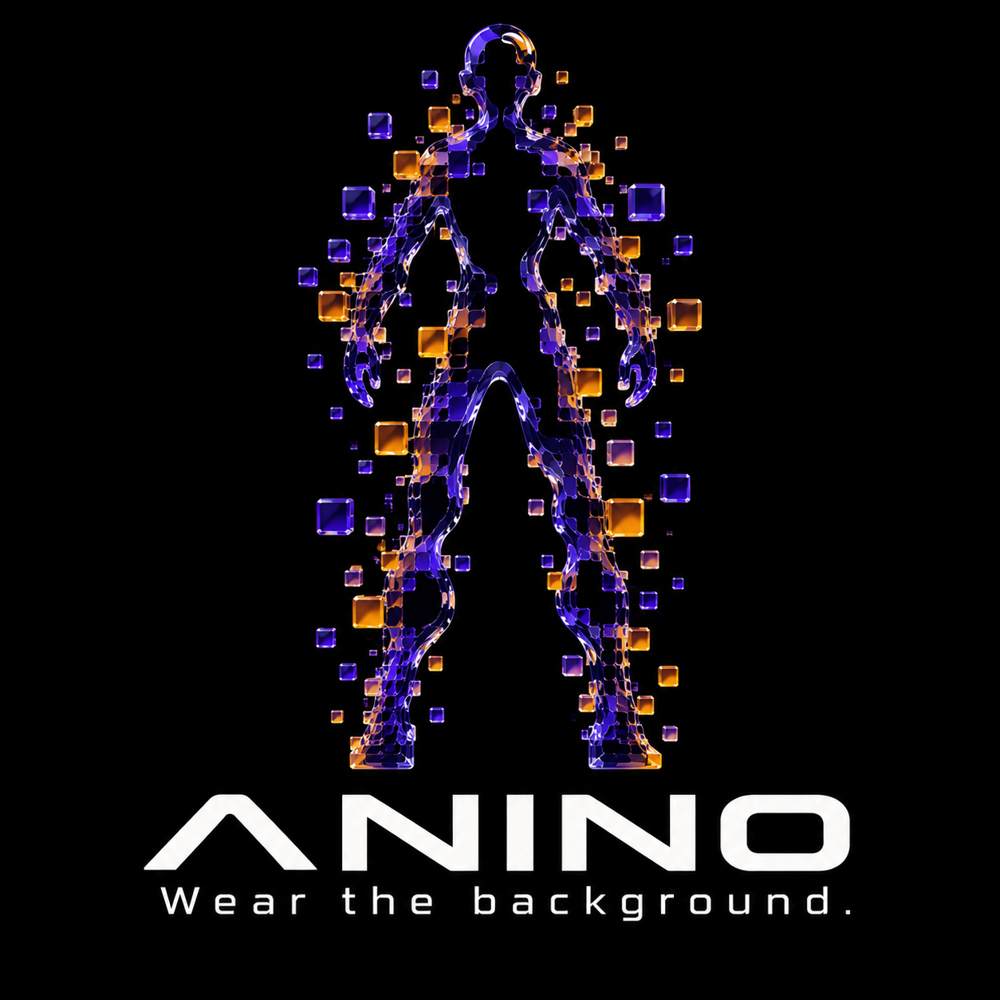

<p align="center"></p>

# ACS Anino: a do-it-yourself active camouflage suit

*"Anino" is Filipino for shadow. Wear the background.*

**Status:** planning · **Started:** 2026-11-19 · **Designer:** Hoofie Puppet
**License:** (c) 2026 Hoofie Puppet, CC BY-NC-SA 4.0 (see the repo's LICENSE)

ACS Anino ("Active Camouflage Suit") is a loose, full-body suit covered in small LED pixels. Cameras on the
back of the suit watch the scene behind you, and a Raspberry Pi shows that picture on the pixels on your front,
so your outline blends into the background. It is built from cheap, common parts and made to be built one
section at a time by an ordinary maker with a hobby printer.

**Status:** planning. Concept, name, logo, parts list and section plan are done. The module case is next.

## What it can and can't do

Nobody can make a person truly invisible. Anino is an **outline breaker**, built on a budget. It works best:

- for a viewer straight in front of you, since the picture is right from one direction only;
- at a distance and in dim light, where coarse pixels and a soft match are enough to hide the shape;
- with slow movement, because the picture has to keep up with you.

Up close, from the side, or in bright light it will read as a glowing blob, and moving viewers will see the
picture shift (parallax).

## How it works

```
[ back camera ] --USB--> [ Pi 4 hub ] --WiFi--> [ ESP32 in every section ]
  sees the scene          cuts the picture              |  drives that section's
  behind you              into slices                   v  strings of pixels
                                               [ pixels on your front ]
                                                 show the scene behind you
```

The pixels are coarse on purpose: roughly one every 5 to 8 cm and about 1,000 in all. That is plenty to break up
a silhouette, it keeps the power draw sane, and a white diffusion layer over them softens the dots into a smooth
picture. The pixels make their own light, so they stay readable in daylight, which a projector cannot do.

## Sections

The suit is a loose, non-stretch coverall cut into seven sections, each a small self-contained module:

| Section | Carries |
| --- | --- |
| Torso front | The Pi 4 hub, the back camera, its own pixels |
| Torso back | The front camera, its own pixels |
| Left arm, right arm | Pixels |
| Left leg, right leg | Pixels |
| Hood | Pixels, mesh face panel |

Every section has:

- its own **pixels**, sewn or snapped onto that piece of the suit;
- its own **ESP32** (WLED-style pixel firmware) that takes its slice of the picture from the Pi over WiFi, so no
  data cable runs between sections;
- its own small **5 V converter and fuse** taking power from a thin 12 V trunk, so a short stays inside its own
  section;
- the same **two-pin XT30 plug** and the same **printed case**: design once, print seven.

Sections join with separable zippers at the shoulders, hips and hood. A loose fit lets air move, which matters in
Philippine heat, and mesh panels under the arms, on the back and over the face let the electronics breathe.

## Power

A 3S (12 V) Li-ion pack feeds a thin trunk line, with a 15 A main fuse. A USB power bank cannot supply the current
(about 15 A at 5 V with everything lit), so do not use one.

## Build stages

1. Plan: concept, name, logo, parts list, section plan. (done)
2. Module design: one printed case for the ESP32, 5 V converter, fuse and plug. (now)
3. Torso front: the Pi, one camera and pixels. Prove the camera-to-pixels loop and measure the lag.
4. Torso back, with the second camera.
5. Arms, one at a time.
6. Legs, one at a time.
7. Hood last: mesh face panel, wiring and comfort.
8. Outdoor test at dusk, then the optional extras (side cameras, gloves and boots).

## Files

- [bill-of-materials.md](bill-of-materials.md): every part with quantities, rough costs and Lazada/Shopee search terms
- [anino-logo.png](anino-logo.png): the logo (violet and amber on black)

No STLs yet: the module case comes first.

Project page: https://hoofiepuppet.neocities.org/anino.html

(c) 2026 Hoofie Puppet. Designs, pictures and build guides: CC BY-NC-SA 4.0.
