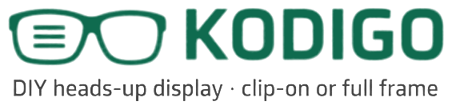
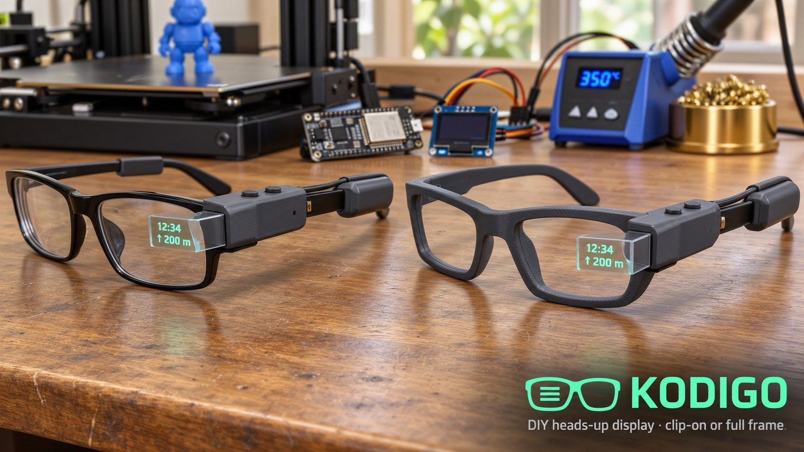

<picture>
  <source media="(prefers-color-scheme: dark)" srcset="kodigo-logo.png">
  <source media="(prefers-color-scheme: light)" srcset="kodigo-logo-dark.png">
  
</picture>

# Kodigo — Parts Repository

*Caption and translation glasses for the hard of hearing.*

**Status:** Planning · **Started:** 2026-11-13 · **Designer:** Hoofie Puppet
**License:** (c) 2026 Hoofie Puppet, CC BY-NC-SA 4.0 (see the repo's LICENSE)
**Shopping list:** [bill-of-materials.md](bill-of-materials.md)



*AI-generated concept image, not an actual build.*

## What it is

Kodigo is a cheap, 3D-printed, Google Glass–style heads-up display made specifically to help people who are **hard of hearing (HoH)**. A tiny screen beside your eye shows **live captions** of what people are saying, floating in front of you, so you can look at the person talking and read their words at the same time. It **translates** too: someone speaking Tagalog can show up as English captions, or the other way round.

The same screen also shows build instructions one step at a time, phone notifications and texts, the time and the battery level.

"Kodigo" is Filipino slang for the cheat sheet you sneak into an exam. This one feeds you the words you'd otherwise miss.

It comes in two ways to wear it, with the **same module** for both:

- **Clip-on:** slides onto the arm of your own glasses.
- **Full frame:** a companion 3D-printed glasses frame (clear or no lenses) for people who don't wear glasses.

Both use one shared mounting rail, so a single Kodigo module moves between them.

## Official logo

- **kodigo-logo.png** is the official Kodigo logo: a glasses icon with three text lines in the lens, "KODIGO" in bright HUD green, and the tagline "DIY heads-up display · clip-on or full frame" in light gray. Transparent background, made for dark backgrounds.
- **kodigo-logo-dark.png** is the same logo in dark green and dark gray, for light backgrounds. GitHub picks the right one for your theme automatically.
- The **-2x** files are the same logos enlarged 2x. They're slightly soft because the original is small.
- It was cut from the first concept image (2026-11-13). Always use these files; don't redraw or restyle the logo.

## How it works

```
 [ ESP32-C3 ] --I2C--> [ OLED display ]
                              |  light
                              v
                       [ lens, 40 mm focal length ]   <- makes the text look
                              |                          about 1 m+ away
                              v
                       [ splitter: HUD film ]         <- see-through mirror at 45°
                              |
                              v
                          your eye  (sees the world AND the text)
```

- The screen sits slightly inside the lens's focal length (about 33–38 mm away), so your eye sees a sharp, enlarged image floating at a comfortable distance instead of a blur 3 cm from your face.
- The mirror reverses the picture, so the firmware draws the screen flipped.
- Captions and translation are done on the **phone** (the ESP32 is far too small for speech recognition). The phone sends each finished line to the glasses over Bluetooth.
- **Splitter (no broken glass, by design):** HUD reflective film (static cling, 0.3 mm), either alone in a printed frame gripping all four edges, or on a 1.5 mm clear acrylic piece (1 × 1⅜ in, scored and snapped from a 4 × 4 in sheet). Film side faces the screen and eye. A glass 50/50 cube stays an optional comparison: brightest, but glass, heavier and about ₱825.
- White OLED text reads best through the mirror. Indoors and at the workbench it's clear; bright Philippine sunlight washes it out.

## What it will show

| Feature | Plan |
|---------|------|
| **Live captions** (main feature) | The Kodigo app on the phone turns speech into text (Google speech recognition) and sends each line to the glasses over Bluetooth. Captions scroll, newest line at the bottom. About a second of delay; needs internet. |
| **Translation** (main feature) | One more step on the phone: speech → text → translate → captions, in the language you read best (e.g. Tagalog ↔ English). On/off with a button. |
| Build instructions | **Step mode:** instructions broken into short steps, one per screen (plus a small diagram if it fits). Next / previous with the buttons on the frame, so your hands stay free. Whole PDF pages are unreadable on a screen this small. |
| Notifications and texts | Forwarded from the phone over Bluetooth. |
| Time | From the phone over Bluetooth (or WiFi time). |
| Battery level | Battery voltage read through a 100k/100k divider into the ESP32's ADC. |

Captions and step mode are separate screens; a button switches between them.

## Brightness, colour and readability

| Setting | Plan |
|---------|------|
| Brightness | 256 levels in software (OLED contrast command). Step it with the frame buttons, or automatic with a BH1750 light sensor on the same I2C wires. |
| Text colour | Mono OLEDs come in one colour, chosen when buying: white (reads best through the mirror), green, blue, yellow, or two-tone (yellow status strip over blue). Optional full-colour SSD1351 OLED for any colour in software (red warnings, green "done"). |
| Readability | The text is light added over the view, so it can't block what's behind it. Brighter text looks more solid; a small tinted shade behind the beam splitter makes it stand out. |

## The Kodigo app (our own)

Kodigo gets its own companion app: a **web app**. Open it in the phone's browser and add it to the home screen, and it works like any other app. No app store, and it updates itself. It will be hosted on the workshop BBS.

- Pairs with the glasses over Bluetooth (Web Bluetooth).
- Starts and stops live captions (Web Speech API) and picks the translation languages.
- Sends build instructions to the glasses, one step at a time.
- Sets brightness, auto-brightness and the caption text size.

**Status:** first version live on the BBS as `kodigo-app.html` (captions + translation on the phone/PC screen; the glasses link is ready for the firmware).

### Glasses Bluetooth protocol (for the ESP32 firmware)

- Advertised name starts with `Kodigo`.
- Nordic UART Service `6e400001-b5a3-f393-e0a9-e50e24dcca9e`; the app **writes** to RX `6e400002-b5a3-f393-e0a9-e50e24dcca9e` in 20-byte chunks.
- UTF-8 lines ending in `\n`:
  - `C:<text>` a finished caption line (already translated if translation is on). Add as a new line.
  - `P:<text>` the line still being spoken. Replace the bottom line (sent about 3×/second, only when translation is off).
  - `X:` clear the screen.

### Phones

| Phone | How |
|-------|-----|
| Android | Chrome. Works as-is. |
| iPhone | Apple doesn't allow Web Bluetooth in iPhone browsers (Chrome on iPhone runs on Safari's engine, so it has the same limit; Android emulators can't reach the iPhone's Bluetooth or mic). Fix: the free **WebBLE** app (iOS 26+), a Safari extension that adds Web Bluetooth, then use the Kodigo app in Safari. Backup: the free **Bluefy** browser. **To be tested on a real iPhone.** A native iPhone app (Swift: CoreBluetooth + Apple's Speech and Translation frameworks, which can run on-device) only if neither works well; it needs a Mac or cloud build and a US$99/year Apple Developer account to share. |

## Build stages

1. **Optics test rig (now).** OLED, lens and beam splitter in a printed holder with adjustable spacing, on the bench. Goal: a sharp, comfortable image. No wearable parts yet.
2. **Electronics on the breadboard.** ESP32-C3 driving the OLED: clock, battery level, then live captions and translation from the Kodigo app.
3. **Wearable module.** The housing, battery pod behind the ear, buttons, power switch.
4. **Mounting rail, clip-on adapter and companion frame.**

## Printed parts

| ID | Part | Material | Status | Notes |
|----|------|----------|--------|-------|
| KD-01 | Optics test rig | PETG | Not designed | Bench holder for the OLED, lens and splitter, with adjustable display-to-lens spacing (about 30–40 mm). Splitter frame grips all four edges. |
| KD-02 | Display module housing | PETG | Not designed | Holds the OLED, lens, beam splitter, ESP32-C3 and buttons. Slides onto the mounting rail. |
| KD-03 | Battery pod | PETG | Not designed | Behind the ear, balances the weight of the module. Holds the LiPo, charger board and power switch. |
| KD-04 | Clip-on adapter | PETG / TPU | Not designed | Puts the mounting rail onto the arm of ordinary glasses. |
| KD-05 | Companion glasses frame | PETG | Not designed | For people who don't wear glasses. Mounting rail built into the right arm. |

## Open questions

- 1.3" OLED is the main screen (more caption lines); compare with the 0.96" through the optics.
- Mono vs full-colour OLED.
- iPhone: test WebBLE (and Bluefy) with captions on a real iPhone.
- Later: a small microphone on the glasses (picks up the person in front of you better than a phone in a pocket).
- Splitter: HUD film alone vs film on acrylic vs (optional) glass cube.
- Exact mounting-rail profile shared by the clip-on adapter and the frame.
