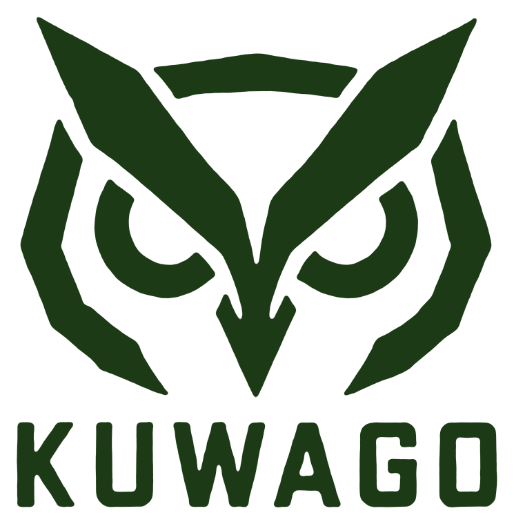
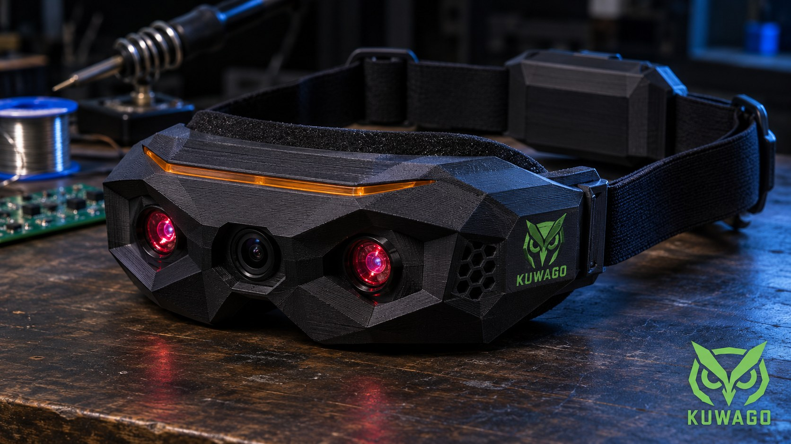

<picture>
  <source media="(prefers-color-scheme: dark)" srcset="kuwago-logo.png">
  <source media="(prefers-color-scheme: light)" srcset="kuwago-logo-dark.png">
  
</picture>

# Kuwago — Parts Repository

*Homemade 3D-printed night vision goggles.*

**Status:** Planning · **Started:** 2026-11-14 · **Designer:** Hoofie Puppet
**License:** (c) 2026 Hoofie Puppet, CC BY-NC-SA 4.0 (see the repo's LICENSE)
**Shopping list:** [bill-of-materials.md](bill-of-materials.md)
**On the BBS:** [hoofiepuppet.neocities.org/kuwago.html](https://hoofiepuppet.neocities.org/kuwago.html)



*AI-generated concept image, not an actual build.*

## What it is

Kuwago is a pair of digital night vision goggles built from a Raspberry Pi Zero, an infrared night-vision camera, a small screen and the two lenses from a Google Cardboard viewer, in a light 3D-printed PLA visor. Two infrared LEDs light up the dark with light your eyes can't see; the camera can, and the goggles show you the live picture.

"Kuwago" is Filipino for **owl**: the bird that sees in the dark. The front even looks like one, with the camera as the beak and the two IR lights as the eyes.

## Official logo

- **kuwago-logo.png**: the official Kuwago logo (green geometric owl face over "KUWAGO"). Transparent background, made for dark backgrounds.
- **kuwago-logo-dark.png**: the same logo in dark green, for light backgrounds. GitHub picks the right one for your theme automatically.
- **kuwago-emblem.png**: the owl only, no lettering.
- **kuwago-icon-180.png**: the owl on black, 180 × 180, for a home-screen or app icon.
- Cut from the first concept image (2026-11-14). Always use these files; don't redraw or restyle the logo.

## How it works

```
 [ 2 IR LEDs ] ~~ invisible light ~~> the dark scene
       |  the camera sees it
       v
 [ IR camera ] --ribbon--> [ Pi Zero ] --HDMI--> [ 3.5" screen ]
                                                        |  the same picture,
                                                        v  shown twice side by side
                                         [ two 25 mm Cardboard lenses ]
                                                        |
                                                        v
                                          both eyes (one sharp picture)
```

- **One camera, both eyes** (bi-ocular, like PVS-7 military goggles). Both eyes see the same flat picture, so there's no fake 3D and no eye strain from it.
- **Optics:** the screen sits just inside the lenses' focal length (listed as 40 mm / 45 mm), so the eye sees a sharp, relaxed picture. A focus slider covers 34–48 mm.
- **Eye spacing:** lens centres are fixed at 63 mm; the software slides the two pictures closer or further apart to match the wearer's eyes, set once and saved.
- **Low lag:** HDMI screen, camera drawn straight to it by the Pi's GPU (no desktop, boots into the live view).
- **No "swimming":** the camera sees wider than the lenses show, so the software crops it until one degree of head turn equals one degree on screen.
- Green "phosphor" or black-and-white view; low-battery warning from the LiPo SHIM.

## Design goals

The SysOp built a night vision goggle years ago from someone else's design: nearly impossible to build, bulky, uncomfortable, front-heavy and ugly. Kuwago is designed against every one of those.

| Goal | How |
|---|---|
| Minimal PLA | Skeleton frame, not a box: the screen is the back wall, the lens plate the front, two slim rails join them. ~60–80 g. |
| Easy to print | ~5 main parts, all flat, no supports, fit an ordinary bed. |
| Easy to put together | Snap fits + a handful of M2.5 screws, no glue, cables in built-in channels. |
| Balanced & comfortable | Pi and SHIM sandwiched between screen and camera, so it stays short. Battery in a pod at the back of the strap as a counterweight. Optional top strap, foam seal, nose cutout, hidden anti-fog vents. |
| Swappable screen | The screen rides in its own tray: unplug HDMI + power, undo two thumb screws, slide it out. Pi, camera and battery stay put. |
| Futuristic look | Faceted visor, three "eyes" on the front, matte black with an optional snap-in translucent accent strip. |

## Parts repository

### Electronics (on hand)

| Part | Key numbers | Notes |
|---|---|---|
| Raspberry Pi Zero | — | Pi Zero 2 W is a drop-in upgrade for a smoother picture. |
| Pimoroni LiPo SHIM | 5 V boost, low-battery pin | Rocker switch goes to **EN + GND** (closed = off), not inline on the battery. |
| PKCELL LP803860 LiPo | 3.7 V, 2000 mAh | ~2½–3 h with the screen and IR on. |
| IR night-vision camera (OV5647) | Board 73 × 25 × 1 mm; IR LEDs Ø18.5 mm, 13 mm tall; lens sticks out 25 mm | LED centres ±27.25 mm from the board centre. Light sensors switch the IR on in the dark; blue screws set the threshold. |
| Pi Zero camera ribbon | ~30 cm | Slack folds flat into a lidded channel; a 10–15 cm ribbon is tidier. |
| Google Cardboard lenses | Ø25.0 mm, centre 5.0 mm, edge ~2.5 mm | Seat: 25.3 mm bore, 2.8 mm deep, 1.0 mm eye-side lip with a 23.0 mm opening; retaining ring with springy tabs (fits a 2.0–3.2 mm edge). |

### Screens (swappable trays)

| Screen | Resolution | Per eye | Notes |
|---|---|---|---|
| MPI3508 3.5" HDMI | 480 × 320 | 240 × 320 | **First screen** (cheap). Must be HDMI, not SPI. Clones vary: tray is measured from the actual unit. Power from the SHIM (5 V + GND). |
| Waveshare 3.5" HDMI LCD (E) | 640 × 480 | 320 × 480 | Upgrade: sharper, capacitive glass, USB-C power, cables included. |

### Printed parts (PLA, matte black) — STLs coming as they're designed and tested

| Part | Qty | Notes |
|---|---|---|
| Front visor | 1 | Camera board on standoffs behind the front wall; Pi + SHIM inside the stack. |
| Lens / focus plate | 1 | Two lens seats 63 mm apart, slides 34–48 mm from the screen, thumb-screw lock. |
| Lens retaining rings | 2 | Springy tabs, clamp the rim only. |
| Face shroud | 1 | Nose cutout, hidden vents, optional gap at the bottom for peripheral view. |
| Screen tray — MPI3508 | 1 | Swappable. |
| Battery pod | 1 | Rides on the back of the strap. |
| Strap clips | 2 | |
| Accent strip *(optional)* | 1 | Translucent, snap-in. |

## Build stages

1. **Parts** — 3.5" HDMI screen next to buy. *(now)*
2. **Bench test** — camera to screen live on the Pi, measure lag, choose the green / B&W look.
3. **Optics** — lenses, focus slider and eye spacing in a printed test frame.
4. **The visor** — frame, screen tray, face shroud, battery pod, strap clips.
5. **Night test** outside, then the upgrade screen tray.

## Comfort tips

Start with 5–10 minute sessions and slow head turns; flip the goggles up between uses. Most people get used to digital NVGs within a few tries.
