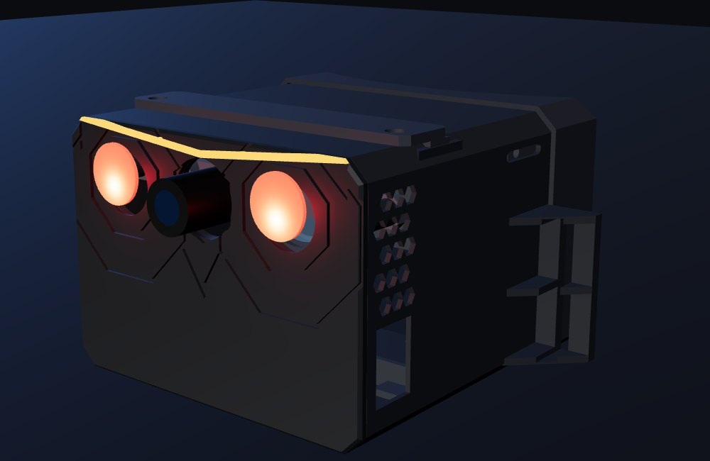
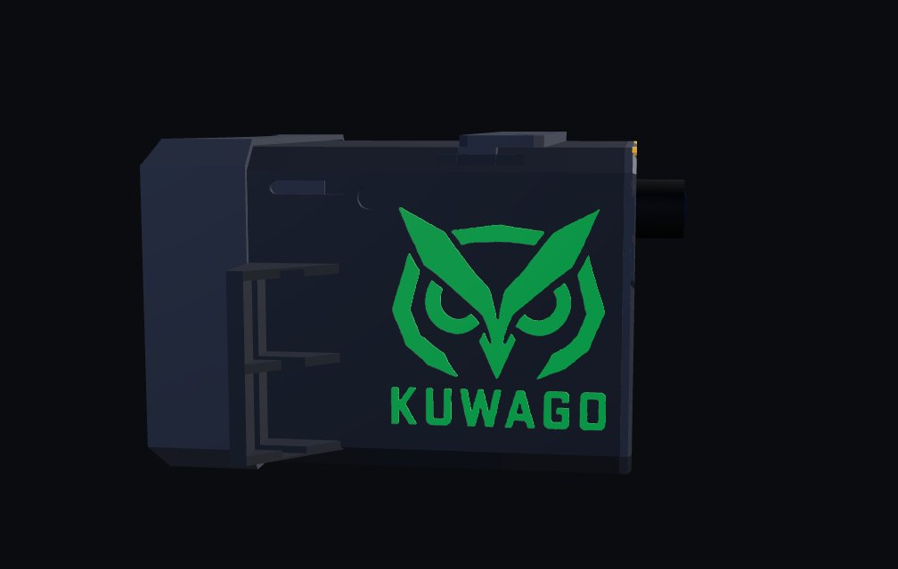
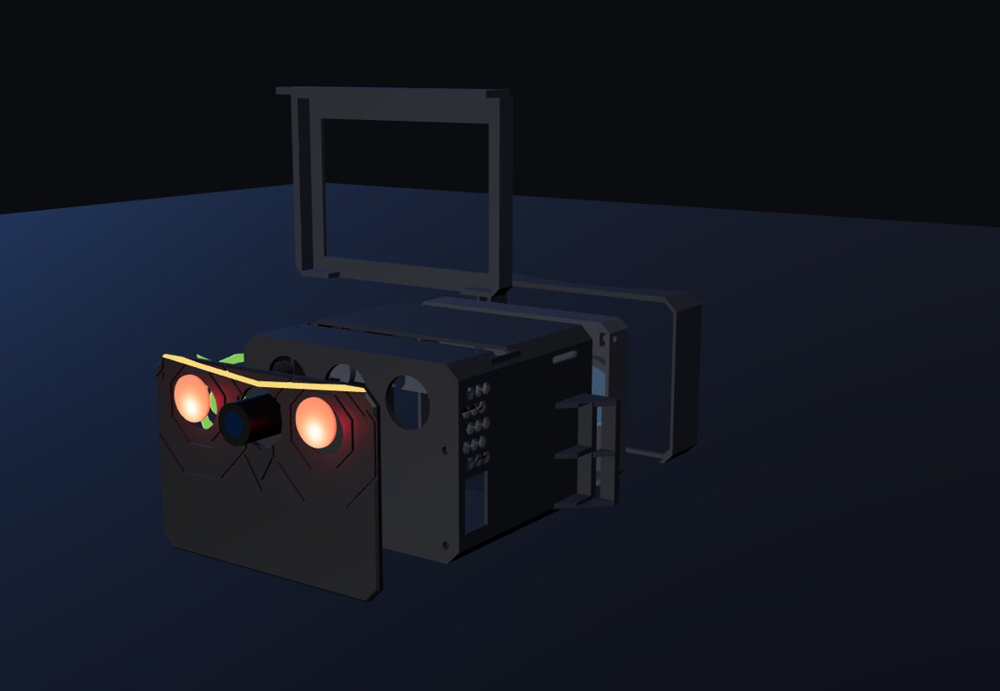

<picture>
  <source media="(prefers-color-scheme: dark)" srcset="kuwago-logo.png">
  <source media="(prefers-color-scheme: light)" srcset="kuwago-logo-dark.png">
  
</picture>

# Kuwago — Parts Repository

*Homemade 3D-printed night vision goggles.*

**Status:** v2.3 designed · STLs ready · screen next · **Started:** 2026-11-14 · **Designer:** Hoofie Puppet
**License:** (c) 2026 Hoofie Puppet, CC BY-NC-SA 4.0 (see the repo's LICENSE)
**Build guide (illustrated, with print settings):** [Kuwago-Build-Guide.pdf](Kuwago-Build-Guide.pdf)
**Shopping list:** [bill-of-materials.md](bill-of-materials.md)
**On the BBS:** [hoofiepuppet.neocities.org/kuwago.html](https://hoofiepuppet.neocities.org/kuwago.html)



## What it is

Kuwago is a pair of digital night vision goggles built from a Raspberry Pi Zero, an infrared night-vision camera, a small HDMI screen and the two lenses from a Google Cardboard viewer, in a light 3D-printed PLA housing. Two infrared LEDs light up the dark with light your eyes can't see; the camera can, and the goggles show you the live picture.

"Kuwago" is Filipino for **owl**: the bird that sees in the dark. The front is an owl's face: the two IR lights are the eyes and the camera is the beak.

| | |
|---|---|
| Size | about **97 × 69 × 87 mm** (129 mm wide across the strap wings) |
| Plastic | about **139 g of PLA**, 12 parts, all print flat, **no supports** |
| Battery | 2000 mAh LiPo in a pod at the back of the head, USB-C charging |
| Runtime | about 2½–3 hours |

## How it works

```
 [ 2 IR LEDs ] ~~ invisible light ~~> the dark scene
       |  the camera sees it
       v
 [ IR camera ] --ribbon--> [ Pi Zero ] --HDMI--> [ 3.5" screen ]
                                                        |  the same picture,
                                                        v  shown twice side by side
                                         [ two 25 mm Cardboard lenses ]
                                                        |
                                                        v
                                          both eyes (one sharp picture)
```

- **One camera, both eyes** (bi-ocular, like PVS-7 military goggles): no fake 3D, no eye strain from it.
- **Optics:** the screen sits just inside the lenses' focal length; a focus slider covers 34–48 mm lens-to-screen.
- **Eye spacing:** lens centres fixed at 63 mm; the software slides the two pictures to match the wearer's eyes.
- **Low lag:** HDMI screen, camera drawn straight to it by the Pi's GPU, boots straight into the live view.
- **No "swimming":** the camera picture is cropped so one degree of head turn is one degree on screen.

## The design (v2.3)



- **Flat rectangle, flush owl face.** The camera sits in the upper half and the Pi Zero in the lower half, both inside the screen's height. Eye rings, facial discs, brow, beak and ear marks are cut *into* the flat front. The IR LEDs sit flush in the eyes.
- **Side logo as 12 glue-in inlays.** Owl head, cheeks, eyes, brow bar and K-U-W-A-G-O print together in green (no mid-print colour change), each into its own recess (+0.10 mm per side, 1.06 mm deep). Tape-transfer trick in the guide.
- **Swappable screen tray.** Unplug HDMI + power, undo 2 screws, lift out. The electronics never move.
- **Balanced.** Battery and charger ride in a pod at the back of the head as a counterweight.
- **Tough cable.** The battery lead is sleeved in gutted 550 paracord. Both cable holes are 4.2 mm sockets that take the paracord's sealed end like a grommet, with a zig-zag strain relief behind each so a tug never reaches the plug.
- **Comfort.** Curved foam face shroud, nose cutout, hidden anti-fog vents.



## Printed parts — [`stl/`](stl/)

All STLs are already oriented for printing. Full settings are in the [build guide](Kuwago-Build-Guide.pdf): PLA, 210–215 °C, 60 °C bed, 0.20 mm layers, 3 walls, 20 % gyroid, **no supports**.

| File | Qty | Notes |
|---|---|---|
| kw-01-shell | 1 | Front wall down. Logo recesses, cable grommet, strain relief built in. |
| kw-02-owl-face | 1 | Flat back down. The flush owl face. |
| kw-03-lens-plate | 1 | Eye side down. Two M2.5 nuts drop into its side pockets. |
| kw-04-lens-ring | 2 | Press-fit lens retainers, 0.12 mm layers. |
| kw-05-screen-tray-mpi3508 | 1 | **v0: wait for your screen.** Clones vary; measure yours and regenerate before printing. |
| kw-06-face-shroud | 1 | Sleeve end down. Foam goes on the curved edge. |
| kw-07-camera-retainer | 1 | |
| kw-08-battery-pod | 1 | Battery + TP4056 charger, strap slots, cable grommet. |
| kw-09-battery-pod-lid | 1 | |
| kw-10-thumb-knob | 2 | Press an M2.5 screw head into each. |
| kw-11-brow-accent | 1 | Optional, translucent amber, presses flush into the brow. |
| kw-12-logo-inlays | 1 plate | 12 green pieces for the side logo. |

## Electronics (key numbers)

| Part | Key numbers | Notes |
|---|---|---|
| Raspberry Pi Zero (or Zero 2 W) | 58 × 23 mm holes | Mounted on the front wall, ports down. |
| Pimoroni LiPo SHIM | 5 V boost | Does **not** charge. Switch to **EN + GND** (closed = off). |
| TP4056 USB-C charger (protected) | — | In the battery pod. |
| PKCELL LP803860 LiPo | 3.7 V 2000 mAh | In the battery pod. |
| OV5647 night-vision camera | board 73 × 25 mm; LEDs Ø18.5 × 13 mm; lens 25 mm | IR always on (its light sensors sit in the dark). |
| MPI3508 3.5" HDMI screen | 480 × 320 | Must be HDMI, not SPI. Upgrade: Waveshare 3.5" HDMI (E) 640 × 480. |
| 90° mini-HDMI FPV ribbon cable | — | Only ~7 mm under the Pi. |
| Google Cardboard lenses | Ø25, 40–45 mm focal length | Seat 25.3 mm, 1.0 mm lip, ring counterbore 27.8 mm. |
| Optional MAX17048 fuel gauge | I2C | On-screen battery % bar. |

## Build stages

1. **Design** — v2.3 STLs and illustrated build guide. ✔
2. **Parts** — MPI3508 screen, 90° mini-HDMI cable, TP4056 charger next. *(now)*
3. **Bench test** — camera to screen live on the Pi, measure lag, pick the green / B&W look.
4. **Print + fit** — shell and owl face first, then the rest; regenerate the screen tray to the real screen.
5. **Night test** outside, then the upgrade screen tray.
