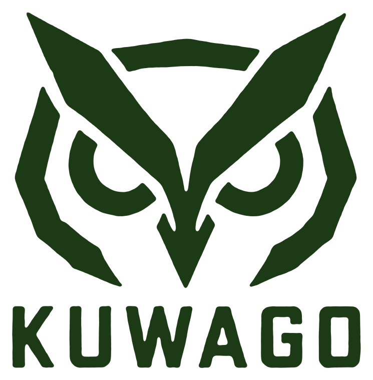
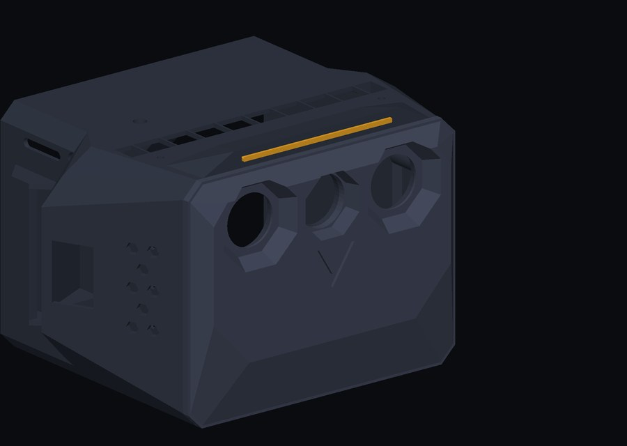
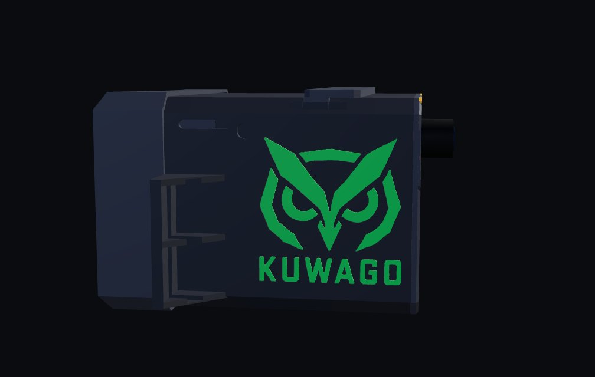
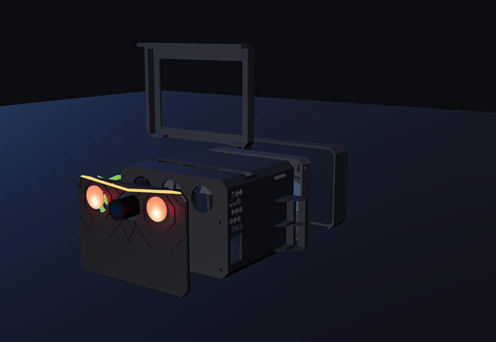

<picture>
  <source media="(prefers-color-scheme: dark)" srcset="kuwago-logo.png">
  <source media="(prefers-color-scheme: light)" srcset="kuwago-logo-dark.png">
  
</picture>

# Kuwago — Parts Repository

*Homemade 3D-printed night vision goggles.*

**Status:** v3.6 designed · print-testing · screen next · **Started:** 2026-11-14 · **Designer:** Hoofie Puppet
**License:** (c) 2026 Hoofie Puppet, CC BY-NC-SA 4.0 (see the repo's LICENSE)
**Build guide (illustrated, with print settings):** [Kuwago-Build-Guide.pdf](Kuwago-Build-Guide.pdf)
**Shopping list:** [bill-of-materials.md](bill-of-materials.md)
**On the BBS:** [hoofiepuppet.neocities.org/kuwago.html](https://hoofiepuppet.neocities.org/kuwago.html)



## What it is

Kuwago is a pair of digital night vision goggles built from a Raspberry Pi Zero, an infrared night-vision camera, a small HDMI screen and the two lenses from a Google Cardboard viewer, in a light 3D-printed housing (PETG; PLA and TPU also work). Two infrared LEDs light up the dark with light your eyes can't see; the camera can, and the goggles show you the live picture.

"Kuwago" is Filipino for **owl**: the bird that sees in the dark. The front is an owl's face: the two IR lights are the eyes and the camera is the beak.

| | |
|---|---|
| Size | about **136 × 80 × 85 mm** (faceted owl-wing shell) |
| Plastic | about **160 g of PETG**, 15 parts, all print flat, **no supports** |
| Battery | 2000 mAh LiPo in a pod at the back of the head, USB-C charging |
| Runtime | about 2½–3 hours |

## How it works

```
 [ 2 IR LEDs ] ~~ invisible light ~~> the dark scene
       |  the camera sees it
       v
 [ IR camera ] --ribbon--> [ Pi Zero ] --HDMI--> [ 3.5" screen ]
                                                        |  the same picture,
                                                        v  shown twice side by side
                                         [ two 25 mm Cardboard lenses ]
                                                        |
                                                        v
                                          both eyes (one sharp picture)
```

- **One camera, both eyes** (bi-ocular, like PVS-7 military goggles): no fake 3D, no eye strain from it.
- **Optics:** the screen sits just inside the lenses' focal length; a focus slider covers 34–48 mm lens-to-screen.
- **Eye spacing:** lens centres fixed at 63 mm; the software slides the two pictures to match the wearer's eyes.
- **Low lag:** HDMI screen, camera drawn straight to it by the Pi's GPU, boots straight into the live view.
- **No "swimming":** the camera picture is cropped so one degree of head turn is one degree on screen.

## The design (v3.6)



*(Side and exploded pictures are from the earlier v2.3 and the look has changed since: the v3.6 shell is faceted.)*

- **Faceted owl face.** A raised faceted face with recessed eye pockets for the two IR LEDs and the camera beak, a brow ridge with an amber strip, and angled owl-wing facets on the sides.
- **Pi flipped, taller shell.** The Pi Zero is mounted with its mini-HDMI port facing the ceiling so a 90° plug fits above it (plug 14.5 mm or shorter). The camera sits in the upper half and the Pi in the lower half.
- **Mode button.** A 6 × 6 mm tactile switch in the top wall with a small printed plunger (kw-15). Wire it between GPIO 17 (pin 11) and GND (pin 14).
- **Headband loops.** Open 4 mm strap slots on both sides, with 45° feet at both ends so they print without supports.
- **Side logo chip.** One piece, black base with the green logo, with a single filament change at 1.2 mm. It glues into a rounded-square pocket on the left facet.
- **Swappable screen tray.** Unplug HDMI and power, undo 2 screws, lift out. The electronics never move.
- **Balanced.** Battery and USB-C charger ride in a pod at the back of the head as a counterweight, on a curved saddle that comes in four sizes (S, M, L, XL).
- **Tough cable.** The battery lead is sleeved in gutted 550 paracord. Both cable holes are 4.2 mm sockets that take the paracord like a grommet, with a zig-zag strain relief behind each.
- **Comfort.** Curved face shroud with a foam lip (3 mm EVA foam ring), nose cutout, vents.



## Printed parts — [`stl/`](stl/)

All STLs are already oriented for printing. Full settings are in the [build guide](Kuwago-Build-Guide.pdf): PETG, 235–240 °C nozzle, 75–80 °C bed (PLA and TPU also work), 0.20 mm layers, **no supports**.

| File | Qty | Notes |
|---|---|---|
| kw-01-shell | 1 | Front wall down. Button boss, headband loops, grommet and strain relief built in. |
| kw-02-owl-face | 1 | Back down (facets up). |
| kw-03-lens-plate | 1 | Eye side down. Two M2.5 nuts drop into its side pockets. |
| kw-04-lens-ring | 2 | Split spring ring, 0.12 mm layers. |
| kw-05-screen-tray-mpi3508 | 1 | **Placeholder: wait for your screen.** Clones vary; measure yours and regenerate before printing. |
| kw-06-face-shroud | 1 | Sleeve end down. The foam ring glues onto its lip. |
| kw-07-camera-retainer | 1 | One piece, pads up. |
| kw-08-battery-pod | 1 | Battery + TP4056 charger, strap slots, cable grommet. |
| kw-09-battery-pod-lid | 1 | Prints inside-face down. |
| kw-10-thumb-knob | 2 | Press an M2.5 screw head into each. |
| kw-11-brow-accent | 1 | Optional, translucent amber, presses flush into the brow. |
| kw-12-logo-chip | 1 | Black base, filament change to green at 1.2 mm. |
| kw-13-pod-saddle-S / M / L / XL | 1 | Pick one size, a bit flatter than your head (L is the default). |
| kw-14-pod-arrow | 1 | Small arrow for the pod lid. |
| kw-15-button-plunger | 1 | Cap for the mode button. |

## Electronics (key numbers)

| Part | Key numbers | Notes |
|---|---|---|
| Raspberry Pi Zero (or Zero 2 W) | 58 × 23 mm holes | Mounted on the front wall, flipped so the mini-HDMI port faces the ceiling. |
| Pimoroni LiPo SHIM | 5 V boost | Does **not** charge. Switch to **EN + GND** (closed = off). |
| TP4056 USB-C charger (protected) | — | In the battery pod. |
| PKCELL LP803860 LiPo | 3.7 V 2000 mAh | In the battery pod. |
| OV5647 night-vision camera | board 73 × 25 mm; LEDs Ø18.5 × 13 mm; lens 25 mm | IR always on (its light sensors sit in the dark). |
| MPI3508 3.5" HDMI screen | 480 × 320 | Must be HDMI, not SPI. Upgrade: Waveshare 3.5" HDMI (E) 640 × 480. |
| 90° mini-HDMI cable | plug 14.5 mm or shorter | The plug points up from the Pi; the cable leaves sideways. |
| 6 × 6 mm tactile switch | ~5 mm tall | Mode button: GPIO 17 (pin 11) + GND (pin 14). Pin 9 is under the LiPo SHIM. |
| Google Cardboard lenses | Ø25, 40–45 mm focal length | Seat 25.3 mm, 1.0 mm lip, ring counterbore 27.8 mm. |
| Optional MAX17048 fuel gauge | I2C | On-screen battery % bar. Use software I2C on GPIO27 (pin 13) and GPIO22 (pin 15), because the normal I2C pins are under the SHIM. |

## Controls and software (planned, not written yet)

One button does everything:

- **Long press (1 s):** next mode: live view → photo → video → Wi-Fi.
- **Double tap:** do the current mode's action (take a photo, start or stop a video).
- **Single tap:** change the look: green phosphor → black and white → raw.
- **Wi-Fi mode:** the goggles start a hotspot and show its name and password on the screen. A page on your phone lists photos and videos to download, and has a slider to set eye spacing. The hotspot turns itself off after about 10 minutes.
- **On-screen overlay (live view only, not saved in clips):** mode label, a REC indicator, battery state, and a faint Kuwago owl watermark.
- **Settings** live in a plain `kuwago.conf` file on the SD card.

## Build stages

1. **Design:** v3.6 STLs and illustrated build guide. ✔
2. **Parts:** MPI3508 screen, 90° mini-HDMI cable and TP4056 charger next. *(now)*
3. **Print-test v3.6:** button and plunger, headband loops, foam lip, ribbon route.
4. **Bench test:** camera to screen live on the Pi, measure lag, pick the green / B&W look.
5. **Fit the screen:** measure your screen and regenerate the tray.
6. **Night test** outside, then the software (button, Wi-Fi page).
