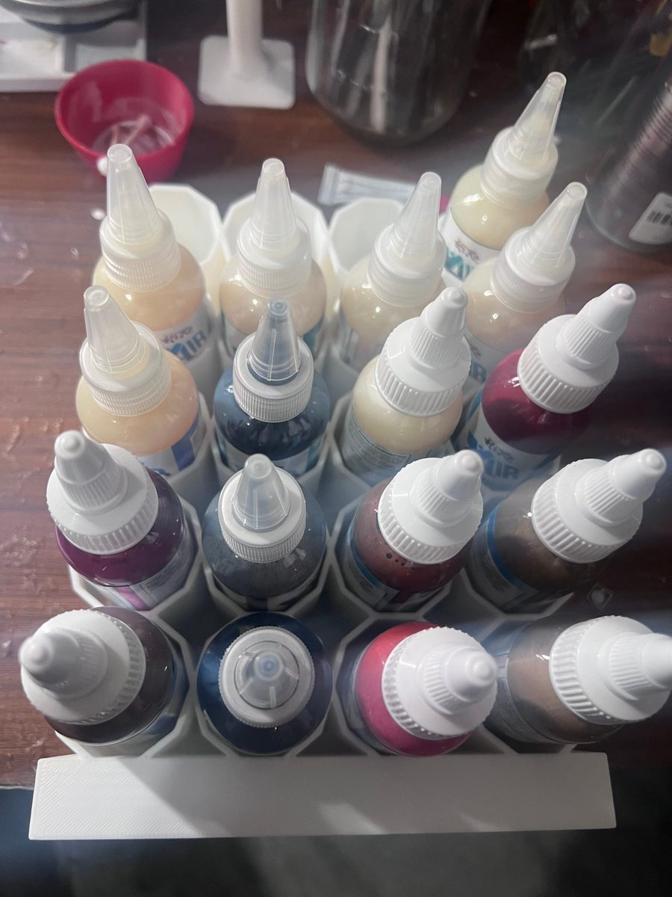
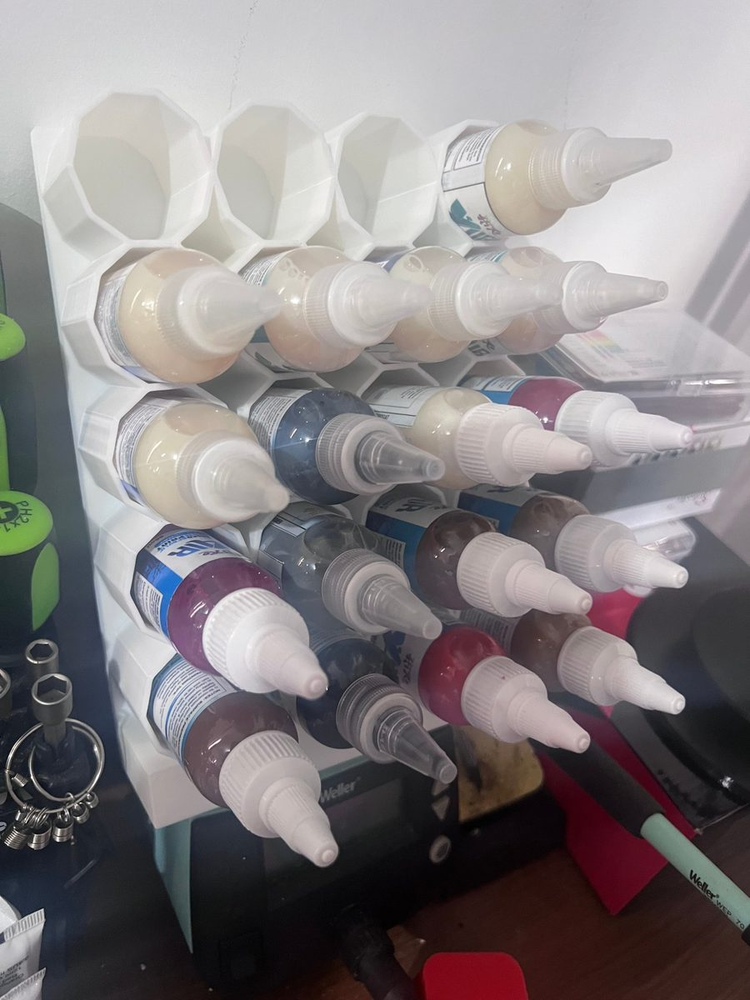

# Airbrush Bottle Holder

**Designer:** Hoofie Puppet · **License:** CC BY-NC-SA 4.0 (see the repo's LICENSE.txt) · **Status:** Released
**On the BBS:** [Odds & Ends](https://hoofiepuppet.neocities.org/smallprints.html#airbrush-bottle-holder)

A holder for 20 airbrush paint bottles, up to 33 mm across. Lay it flat on the desk and the bottles stand up in it. Or lean it against the wall, and the bottles tip forward with their nozzles out, so every colour is right in front of you.

## Print
`Airbrush_Paint_Holder.stl`

- Print it flat, exactly as the STL is laid out.
- It's 220 x 162 mm and 50 mm tall, so it fits most printer beds.

## Use
- Flat: set it on the desk and stand the bottles in it.
- Leaning: stand it up against a wall. The bottles sit at an angle with the nozzles toward you.
- Bottles up to 33 mm across fit. Check bigger ones before you print.
