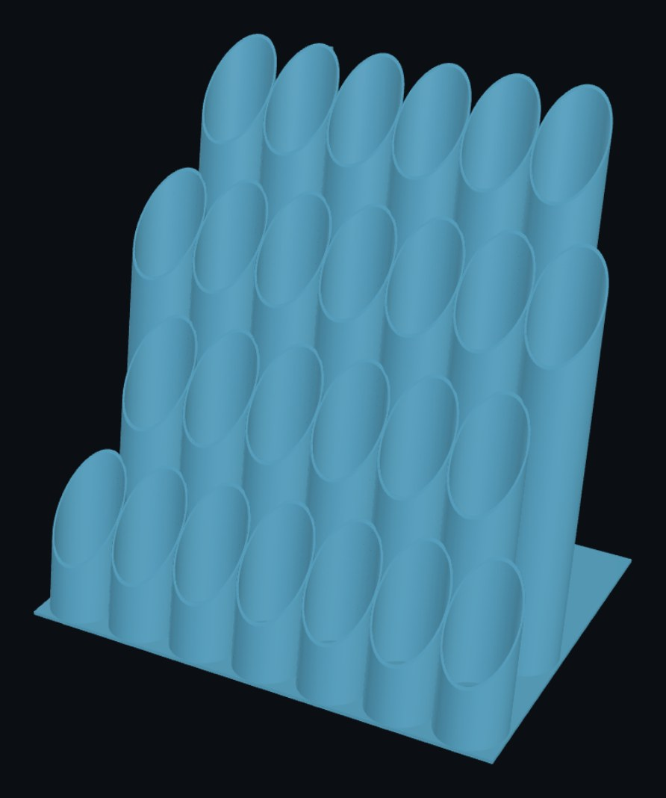
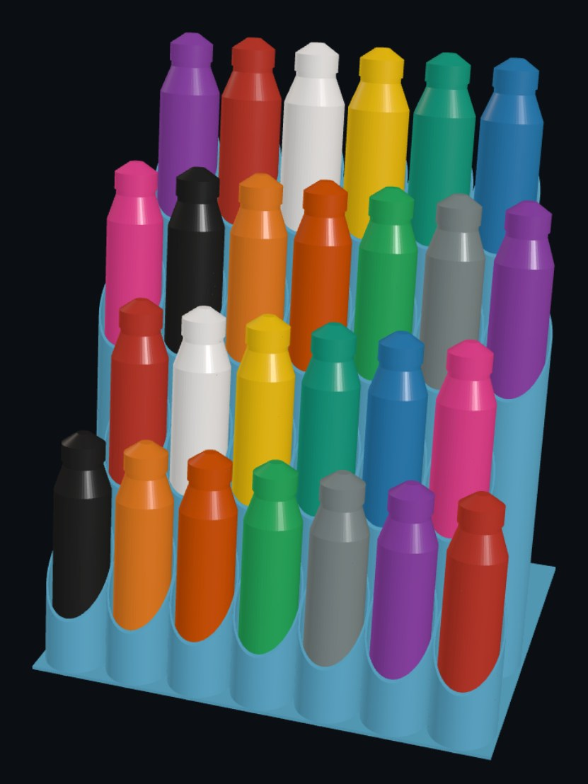

# Airbrush Paint Rack

**Designer:** Hoofie Puppet · **License:** CC BY-NC-SA 4.0 (see the repo's LICENSE.txt) · **Status:** Released, not yet test printed
**On the BBS:** [Odds & Ends](https://hoofiepuppet.neocities.org/smallprints.html)

A desk rack of hollow tubes for 26 airbrush paint bottles, in four rows (7, 6, 7, 6) that step up toward the wall. Any tube takes a 33 mm or 35 mm bottle about 122 mm tall. The bottles lean back 10°, and each tube is cut low at the front so you can see your colours.

## Print
`Airbrush Paint Rack.stl`

- Print it standing up, exactly as the STL is laid out, with no supports.
- 0.2 mm layers, 3 walls, 15% infill, 5 top and bottom layers.
- It needs a build area of 271 x 201 mm and 280 mm of height, and about 850 g of filament.

## Use
- Set it against a wall. It's 271 mm wide, 201 mm deep and 280 mm tall.
- Allow about 410 mm of height, so the top row's bottles can lift straight out.
- Tube inside diameter is 36.4 mm. Check the fit on your own bottles.
- A dab of paint on each cap helps you spot the colour on nearly empty bottles.
