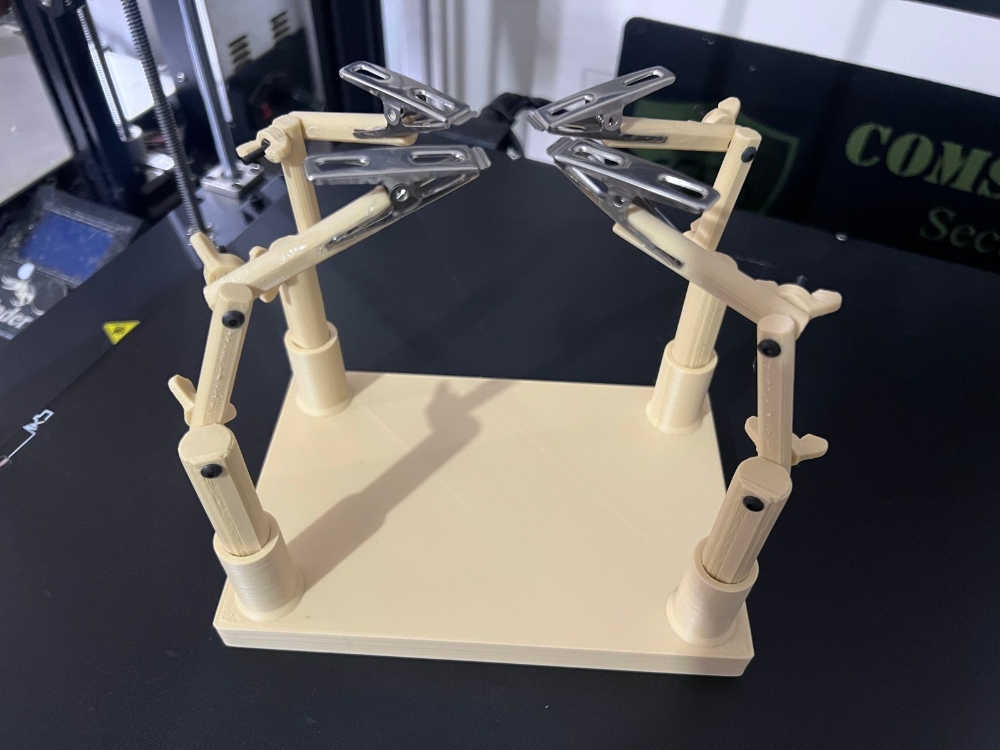

# Helping Hands 2000

**Designer:** Hoofie Puppet · **License:** CC BY-NC-SA 4.0 (see the repo's LICENSE.txt) · **Status:** Released
**On the BBS:** [Odds & Ends](https://hoofiepuppet.neocities.org/smallprints.html)

There are plenty of printable "helping hands" out there, but the snap-together ones rarely work well: they break or are hard to put together. So I designed my own, the Helping Hands 2000. Mine also moves in Z.

## Print
0.2 mm layers, 3 walls, 15% infill. Use mouse ears on the base.

| File | Qty |
|---|---|
| `Base.stl` | 1 |
| `Part_A.stl` | 4 |
| `Part_B.stl` | 4 |
| `Part_C.stl` | 4 |
| `Butterfly_Nut.stl` | 8 |

## Hardware
- 8x M3 nuts
- 8x M3 screws (any M3 style you like)

## Assembly
1. Press the 8 M3 nuts into the Butterfly Nuts.
2. Push the 4 Part A posts into the base.
3. Join Parts B and C with M3 screws. That's it!

I used some clamps from around the house instead of alligator clips (and modded Part C to fit them), but you can always remix it to hold classic alligator clips.
