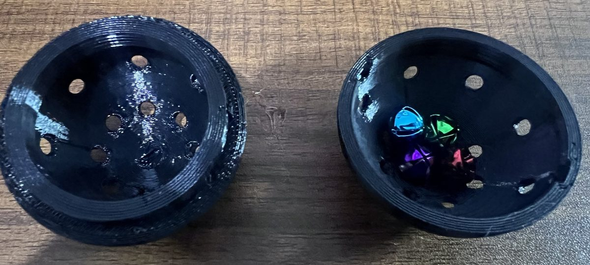
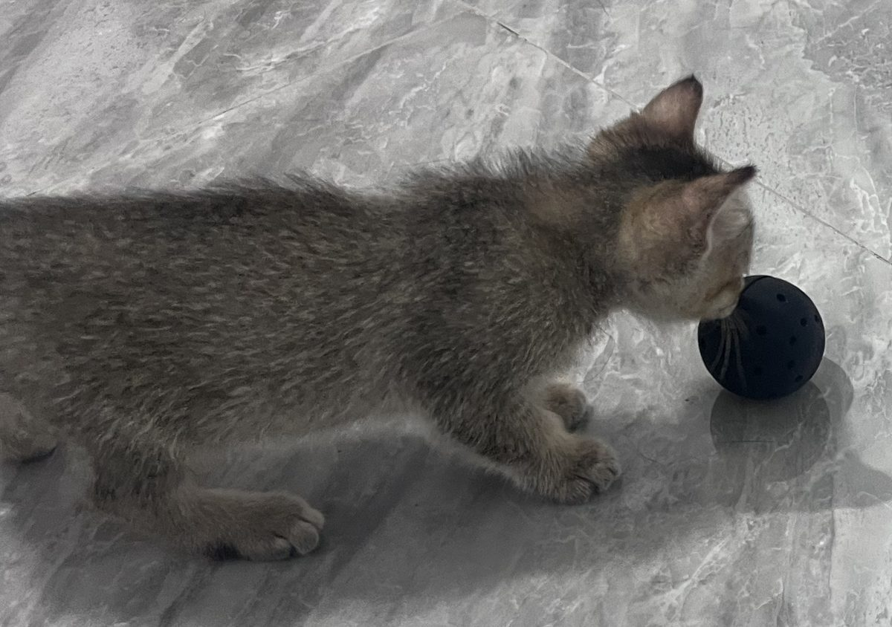

# Kuting Kalansing

**Designer:** Hoofie Puppet · **License:** CC BY-NC-SA 4.0 (see the repo's LICENSE.txt) · **Status:** Released
**On the BBS:** [Odds & Ends → For the Cats](https://hoofiepuppet.neocities.org/smallprints.html#kuting-kalansing)

*Kuting* is Filipino for kitten, and *kalansing* is the jingle of little bells. A 50 mm jingle ball in two halves that lock together, with a few small bells inside. Kitten-approved.

## Files
| File | Notes |
|---|---|
| `Cat_Toy_v3.stl` | Both halves on one plate. Left half: the one with the locking tabs. Right half: the plain one the tabs lock into. |

## Print
- **PETG only.** It's tougher than PLA and takes the chewing and batting.
- **30% infill.**
- **No supports** on the right half. The left half has the locking tabs that go into the right half.
- Ball is 50 mm across; the halves are 30 mm and 24 mm tall.

## Assemble
1. Drop a few small **9 mm bells** into one half.
2. Put **just a drop of CA glue (super glue)** on the locking tabs, then press the halves together until they lock.
3. **Let it dry fully, without moving it,** before you give it to the cats.

> **Safety:** the bells are a choking hazard if the ball comes apart. Check it now and then, and take it away if it cracks or the halves loosen.
