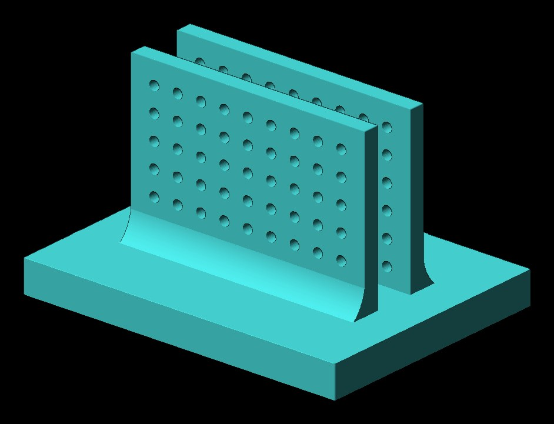

# Laptop Stand

**Designer:** Hoofie Puppet · **License:** CC BY-NC-SA 4.0 (see the repo's LICENSE.txt) · **Status:** Released
**On the BBS:** [Odds & Ends](https://hoofiepuppet.neocities.org/smallprints.html)

A simple stand that holds a Dell (or similar) laptop upright between two uprights, to save desk space.

## Print
`Laptop Stand.stl`

- Base: 100% infill.
- Upper parts (the two uprights): 30% gyroid infill.
- It's one file, so use a height-range modifier in your slicer: 100% for the base (the bottom 20 mm), 30% gyroid above it.
