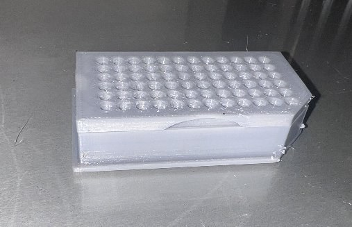
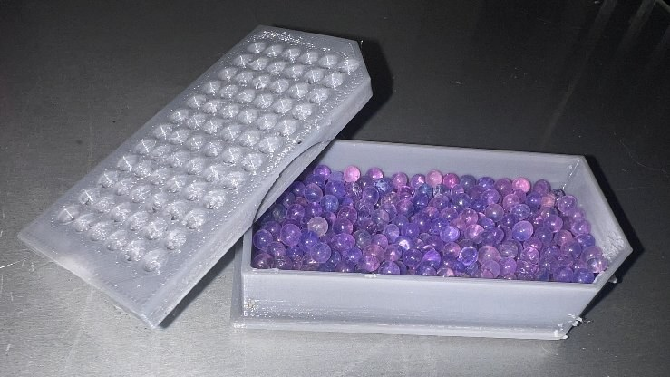

# No-Moist

**Designer:** Hoofie Puppet · **License:** CC BY-NC-SA 4.0 (see the repo's LICENSE.txt) · **Status:** Released
**On the BBS:** [Odds & Ends](https://hoofiepuppet.neocities.org/smallprints.html)

Don't spend your hard-earned money on disposable Dry-Bricks for your hearing aid dryer every couple of months! Print the No-Moist box and lid and fill it with rechargeable desiccant.

> **WARNING: print in PETG or ABS only.** PLA will melt and can ruin your hearing aid dryer. I'm not responsible for your hearing aids: always check with your audiologist first.

## Files
| File | Notes |
|---|---|
| `No-Moist_Box.stl` + `No-Moist_Box_Lid.stl` | Version 1 |
| `No-Moist_Box_V2.stl` + `No-Moist_Box_Lid_V2.stl` | Version 2, with cut-out sides if your dryer needs them |

Material: **PETG or ABS only.**

## Use
1. Fill the box about halfway with rechargeable desiccant, for example https://www.amazon.com/dp/B0C6PDZ5VM
2. When it's spent, recharge it in a metal container in the oven, or in a microwave-safe bowl, following the desiccant's instructions.

