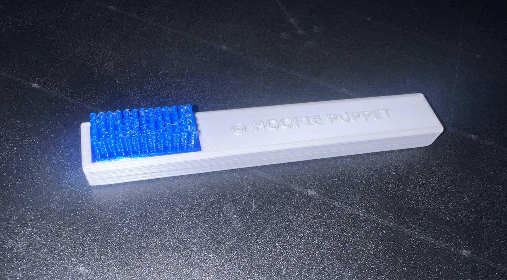
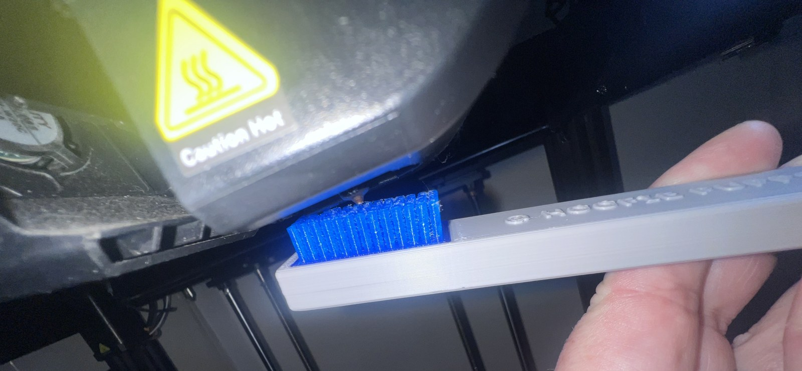

# Nozzle Brush

**Designer:** Hoofie Puppet · **License:** CC BY-NC-SA 4.0 (see the repo's LICENSE.txt) · **Status:** Released
**On the BBS:** [Odds & Ends](https://hoofiepuppet.neocities.org/smallprints.html)

A simple brush for cleaning your printer's nozzle. The handle is PLA and the bristles are TPU. Print the two parts and glue them together.

## Files
| File | Material | Notes |
|---|---|---|
| `Nozzle_Brush_Handle.stl` | PLA | 15% infill |
| `Bristles.stl` | TPU | 15% infill on the bristle base, 0% infill on the bristles themselves |

## Build
Glue the bristles into the handle.

