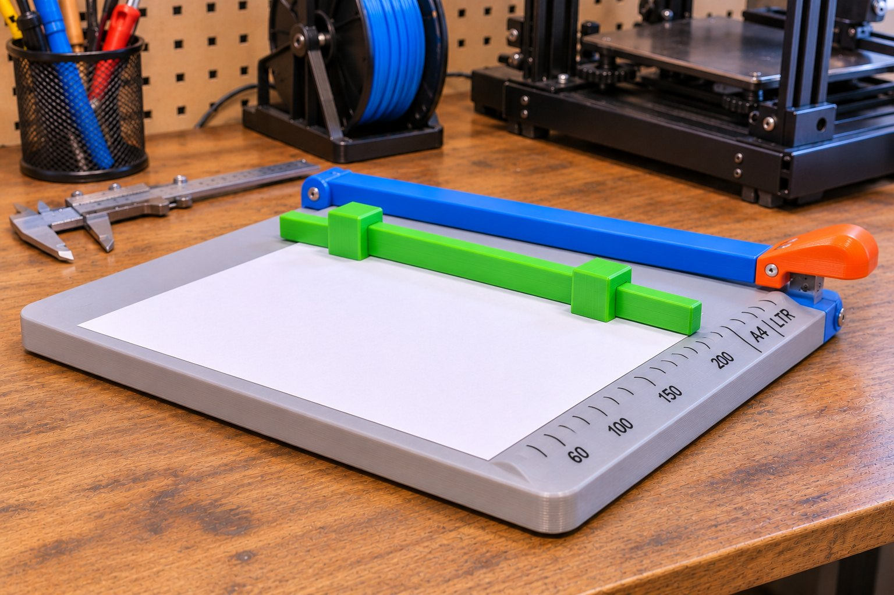
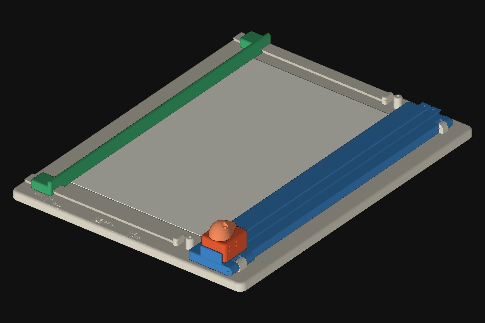

# Paper Cutter

**Designer:** Hoofie Puppet · **License:** CC BY-NC-SA 4.0 (see the repo's LICENSE.txt) · **Status:** Designed, print-testing
**On the BBS:** [Odds & Ends → Workshop Tools](https://hoofiepuppet.neocities.org/smallprints.html#paper-cutter)

A flat desk-top paper guillotine that uses a standard **18 mm snap-off box-cutter blade**. Lift the lever, lay the paper against the sliding fence, lower the lever and push the carriage front to back. Cuts paper up to about 220 mm wide and 300 mm long (A4 and Letter both fit), and you can halve a sheet: the offcut slips out the open right side.

*The first picture is an AI-generated concept reference, not the actual build. The second is a render of the real design.*

The illustrated **[build guide (PDF)](Paper-Cutter-Build-Guide.pdf)** covers how it works, assembly, safe use, blade handling, the pet/kid lock and print settings.

## Files
| File | Print | Notes |
|---|---|---|
| `papercutter_1a_base_A_front_left.stl` | 1 | Base piece A |
| `papercutter_1b_base_B_back_left.stl` | 1 | Base piece B |
| `papercutter_1c_base_C_front_right.stl` | 1 | Base piece C (has the recess for the guard flange) |
| `papercutter_1d_base_D_back_right.stl` | 1 | Base piece D |
| `papercutter_9_bowtie_key_x9.stl` | 9-10 | Bow-tie keys that join the base pieces (print a spare) |
| `papercutter_2_clamp_bar.stl` | 1 | Lever / clamp bar |
| `papercutter_3_carriage.stl` | 1 | Carriage that holds the blade |
| `papercutter_4_fence.stl` | 1 | Sliding paper fence |
| `papercutter_5_garage_guard.stl` | 1 | Hides the blade tip when parked (already flipped for printing) |
| `papercutter_6_blade_gauge.stl` | 1 | 2 mm shim for setting the blade height |
| `papercutter_7_latch_button_x2.stl` | 2 | Turn-button latches that lock the bar |
| `papercutter_8_carriage_handle.stl` | 1 | Teardrop handle, screws onto the carriage |

## Print
- PLA or PETG, 0.2 mm layers, **no supports**. Every file is already in print orientation.
- The base is **4 pieces** (each under 201 × 190 mm), joined by **9 bow-tie keys** pressed into pockets on the underside, plus a little CA glue. Lay the pieces upside down with the seams touching, press the keys in, glue, and weight flat until dry.
- Base pieces and bar: 3-4 walls, 15-20% infill, a small brim. Small parts (guard, gauge, latch buttons, keys): 5 walls / 100% infill.
- Fits are set for **0.25 mm dovetail clearance** and a 2.1 mm hinge-pin hole. It is untested on other printers: sand lightly or tune after the first print.

## You'll also need
- An 18 mm snap-off blade.
- Offcuts of 1.75 mm filament: about 45 mm and 22 mm for the hinge pins, and 4 × 7 mm for the guard pins.
- M3 screws: 4 × 16 mm (blade clamp), 2 × 20 mm (handle), 2 × 12 mm (latches), 2 × 10 mm (rear carriage stop).
- CA (super) glue or epoxy. Optional rubber feet under the base.

## Safety
Treat every blade, including snapped-off pieces, as razor sharp. Wear eye protection when snapping a blade, change blades only with the carriage parked, keep hands behind the handle, and put used pieces in a closed rigid container. Paper and thin film only (about 3 mm at most). Lock the bar when it isn't in use, and keep it away from kids and pets. See the build guide for details.
