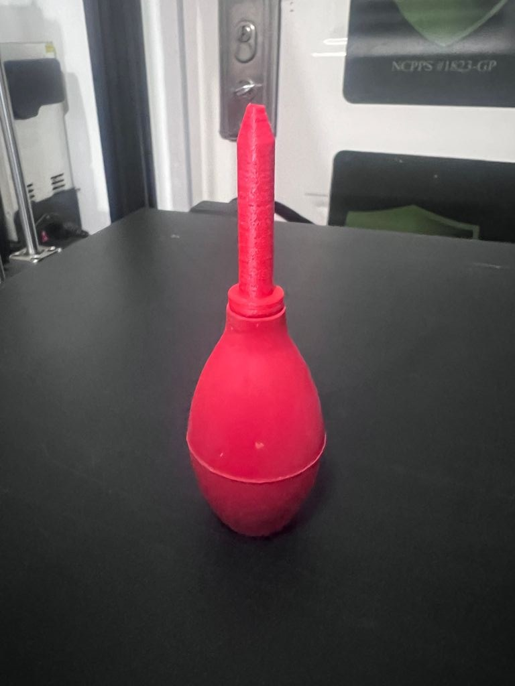

# Solder Bulb Tip

**Designer:** Hoofie Puppet · **License:** CC BY-NC-SA 4.0 (see the repo's LICENSE.txt) · **Status:** Released
**On the BBS:** [Odds & Ends](https://hoofiepuppet.neocities.org/smallprints.html)

A replacement tip for a desoldering bulb. Print a new one when the old tip wears out or melts.

## Files
| File | Material |
|---|---|
| `Solder_Bulb_Tip.stl` | ABS or PETG (they stand up to the heat better than PLA) |
