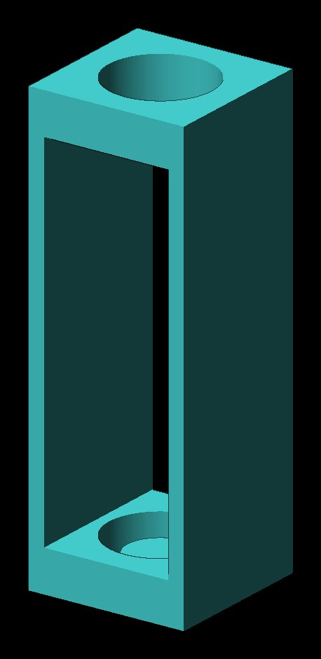

# Spirit Level Holder

**Designer:** Hoofie Puppet · **License:** CC BY-NC-SA 4.0 (see the repo's LICENSE.txt) · **Status:** Released
**On the BBS:** [Odds & Ends](https://hoofiepuppet.neocities.org/smallprints.html)

A holder for the common 9.5 mm x 39.5 mm spirit level vial. I needed a small level for smaller projects, so I took the vials out of an old Harbor Freight level. The window lets you see the bubble.

## Print
`Bubble Level Holder V2.stl`

- Print it on its side, with tree supports.
- 100% infill.
- Put a little hot glue in the top to hold the vial in place.
