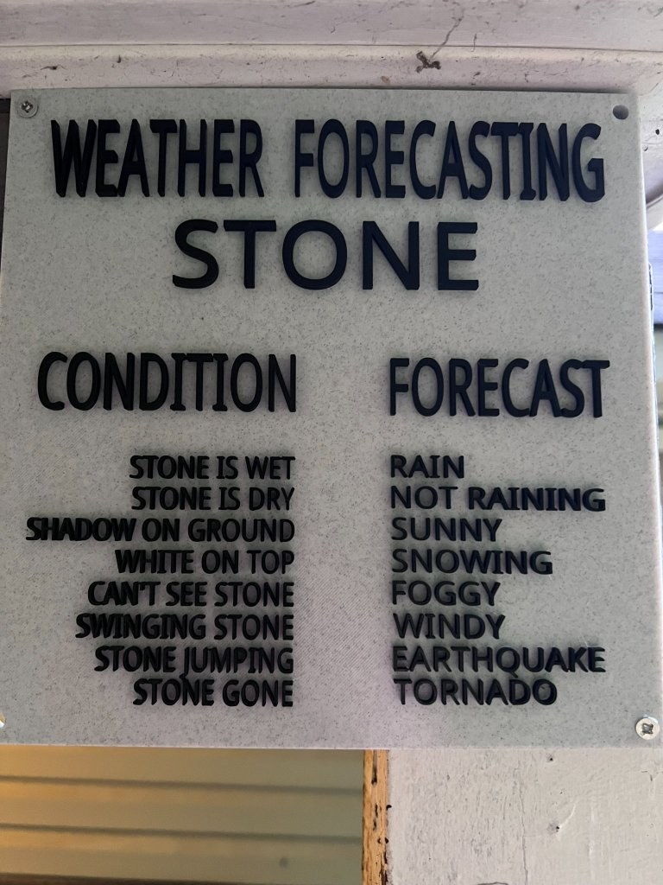
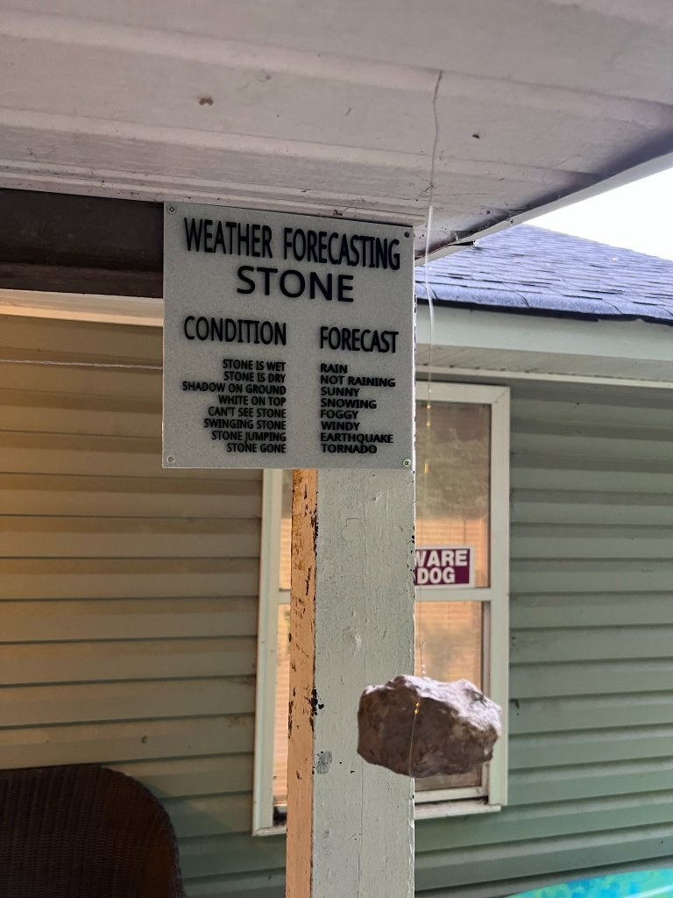

# Weather Forecasting Stone

**Designer:** Hoofie Puppet · **License:** CC BY-NC-SA 4.0 (see the repo's LICENSE.txt) · **Status:** Released
**On the BBS:** [Odds & Ends](https://hoofiepuppet.neocities.org/smallprints.html)

Your own private weather forecast! Print the sign, find a stone in your yard, and hang it under the sign with wire or string. Voila!

## Print
`Forecasting_Stone.stl`: print the sign flat and do a filament colour change where the lettering starts.

