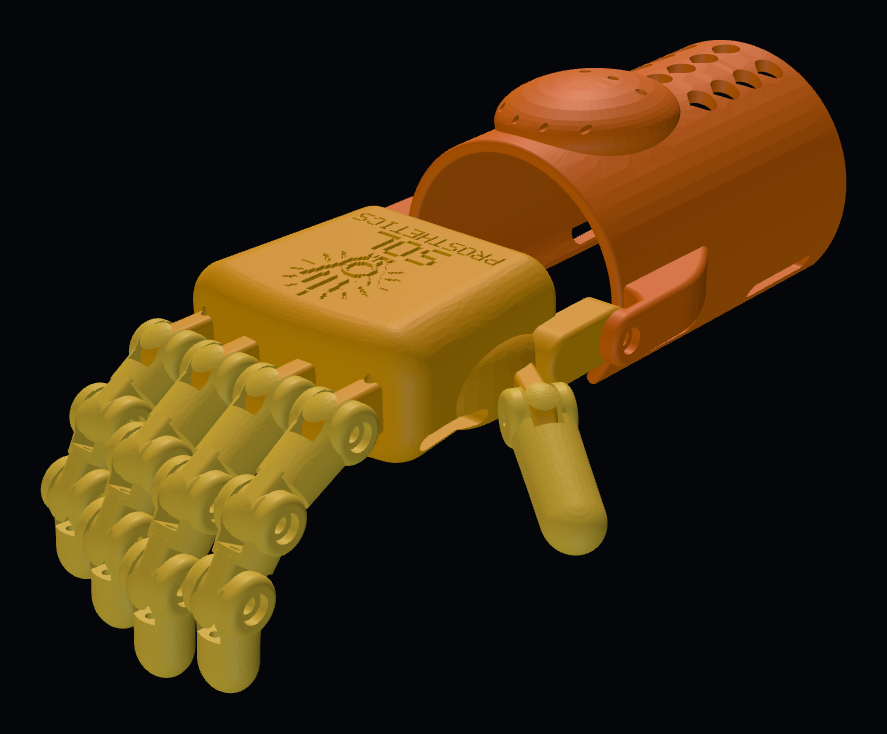

# Sol Prosthetics — Parts Repository

*Open-source hands for Filipino kids. Built for the heat.*

**Status:** In design · **Started:** 2026-10-17 · **Designer:** Hoofie Puppet
**License:** (c) 2026 Hoofie Puppet, CC BY-NC-SA 4.0 (see the repo's LICENSE)
**Shopping list:** [bill-of-materials.md](bill-of-materials.md)
**Hand sizer:** on the workshop BBS, Projects page → "Run the Hand Sizer"

## What it is

3D-printed prosthetic hands for children in the Philippines who are missing a hand, from about age 6 to 18 (some adults too). Most families here can't get or afford a prosthesis, so these are designed to be cheap, easy to print, and easy to fix with parts from any hardware store. They are made for a hot, humid climate: no PLA, no glue, a washable liner, and parts that won't warp in a hot jeepney.

Sol (sun) because it's hot here.

This is an assistive device, not a medical device. Fit every hand with the child's parent or guardian, and with a physical or occupational therapist whenever possible.

## Official logo

- **solprosthetics-logo.png** is the official Sol Prosthetics logo: a pixel-art mechanical hand with jointed fingers and a sun in the palm, orange rays around it, and "SOL PROSTHETICS" in chunky yellow pixel letters. Black background.
- **solprosthetics-logo-3x.png** is the full-size original (1254 × 1254) for big uses like stickers and banners.
- The black background is part of the design (the yellow doesn't read on white), so it works on both GitHub themes as-is.
- Made 2026-10-17 with ChatGPT from the Sol Prosthetics logo prompt. Always use these files; don't redraw or restyle the logo.
- On the website it's **images/solprosthetics-featured.png**.

## The models

Each model is its own design. The child gets the model for their age; the sizer can override it (a small 12-year-old may fit Model 1 better).

| # | Name | Ages | Type |
|---|------|------|------|
| 1 | **Bukang-liwayway** ("Sunrise") | ~6–9 | Simple mechanical. Light, bright colours. |
| 2 | **Sinag** ("Ray") | ~10–13 | Mechanical, stronger grip, adjustable tension. |
| 3 | **Tanghali** ("High Noon") | ~14–18+ | MyoWare muscle-powered. |

Models 1 and 2 close the fingers by cable when the child bends the wrist (needs a working wrist and some palm). An elbow-driven version for kids missing more of the forearm is an open decision.

## Sizing

Two measurements of the child's **good** hand:

1. **Width** across the knuckles.
2. **Length** from the wrist crease to the tip of the middle finger.

```
print scale = (child width + child length) ÷ (model width + model length at 100%)
```

Round **up** to the next 5% so the child grows into it. Optional: measure around the thickest part of the affected forearm to check the cuff (forearm + 10 mm liner vs. the cuff's inside circumference at that scale).

The Hand Sizer page does all of this and makes a fitting card to keep for refits. **The model sizes in the sizer are placeholders** until each model is designed; update them in the sizer's SysOp setup.

This replaces the Enabling the Future multi-hand spreadsheet, which works out to the same formula.

## Printed parts



Part IDs: SP1 = Bukang-liwayway, SP2 = Sinag, SP3 = Tanghali.

| ID | Part | Material | Status | Notes |
|----|------|----------|--------|-------|
| SP1-01 | Palm | PETG | **v2 test print** | Organic, tapered palm with the logo pressed into the back; hidden line tunnels; open palm side with strap slots; angled thumb mount. |
| SP1-02 | Fingers (×4, 3 segments each) | PETG | **v2 test print** | Modular: a broken segment is a quick reprint, not a new hand. |
| SP1-03 | Gauntlet / forearm cuff | PETG | **v2 test print** | Tapered, rounded cuff with teardrop vents. Hinged to the palm at the wrist. Tensioner bump with screw line clamps. |
| SP1-06 | Thumb | PETG | **v2 test print** | Positionable: set the angle, tighten the screw. |
| SP1-04 | Fingertip and palm pads | TPU | Not designed | Grip. Mechanical fit, no glue. |
| SP1-05 | Joint return parts | TPU | v2 | Open the fingers again. v1 uses elastic cord for now (easy to swap while testing). |
| SP2-xx | Sinag parts | PETG / TPU | Not designed | Starts from Model 1 once it's proven; adds stronger grip and an adjustable tensioner. |
| SP3-xx | Tanghali parts | PETG / TPU | Not designed | Phase 2. Adds a sealed electronics box, motor/servo mount and battery holder. |

## Design rules

- **No PLA.** It softens around 55–60 °C. PETG or ASA for rigid parts, TPU for pads and flexible parts.
- **No stick-on or glued parts.** Screws, pins and mechanical fits only (hot, humid climate).
- **Hardware-store parts.** Stainless screws in one common size, braided line, hook-and-loop straps. A parent should be able to fix it with one tool.
- **Washable, ventilated liner** inside the cuff. Kids sweat into it all day.
- **Modular and reprintable.** Every part can be swapped on its own.
- **Light.** Keep weight down, especially far from the elbow. Kids tire quickly.
- **Electronics (Tanghali) stay sealed** from sweat and rain.

## Safety (every fitting)

1. **Skin checks.** After the first hour, the first day and the first week, look for red marks or rubbing. Red marks that don't fade within about 20 minutes mean the fit needs changing.
2. **No sharp edges.** Sand or round every edge and print seam that touches skin.
3. **Small parts.** Make sure pins and screws can't come loose for younger children.
4. **Heat.** Don't leave the hand in direct sun or a hot vehicle. Check it isn't hot before putting it on.
5. **Pinch points.** Check finger joints and the wrist hinge can't pinch the child's skin.
6. **Tanghali only:** fused battery, no exposed wiring, and the hand must open if the battery dies.
7. **Consent.** The parent or guardian agrees to the fitting and knows how to check the skin.

## Open decisions

- Elbow-driven version for children without a working wrist.
- Strap and liner material.
- Tanghali: motor or servo choice, microcontroller, battery.
- Each model's real 100% size (then update the sizer).

## Build order

1. Design Bukang-liwayway (Model 1). Print a test hand at 100%, then measure it and put its real sizes into the sizer. **v2 test print is ready: [bukang-liwayway/](bukang-liwayway/README.md).**
2. Test fit with a child (with a therapist if possible). Fix what the fitting shows.
3. Design Sinag from the proven Model 1.
4. Bench-test the MyoWare sensor and motor before designing Tanghali.

## Change log

- 2026-10-17: Repository started. Name (Sol Prosthetics), the three models, sizing rule and Hand Sizer decided.
- 2026-10-17: Official logo added (solprosthetics-logo.png).
- 2026-10-18: Bukang-liwayway v1 test print: STLs, hardware list and assembly steps in [bukang-liwayway/](bukang-liwayway/README.md). Joints use M3 × 12 stainless screws that thread into the plastic (no nuts).
- 2026-10-18: Bukang-liwayway v2: organic, human-like shapes, logo pressed into the back of the hand, hidden line tunnels, rounded gauntlet.
