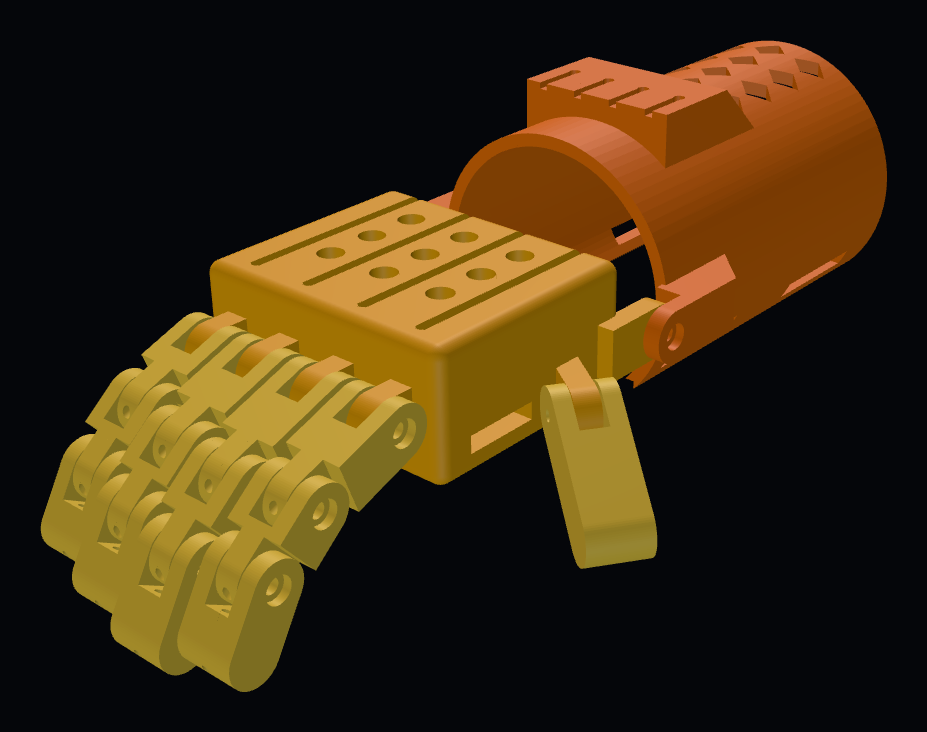

# Bukang-liwayway ("Sunrise"), Model 1, v1 test print

**Ages:** about 9 and under · **Status:** v1 test print (not yet fitted to a child) · **Updated:** 2026-10-18
**Designer:** Hoofie Puppet · **License:** CC BY-NC-SA 4.0 (see the repo's LICENSE)

A wrist-driven hand. When the child bends the wrist down, braided lines running under each finger pull the fingers closed. Bending the wrist back lets them open. The thumb is positionable: set its angle, then tighten its screw.

> **v1 is for test printing and checking the mechanism, at 100% only.** Don't scale these STLs in the slicer yet: the screw holes are sized for M3 and would come out wrong. Sized STLs from the Hand Sizer number come in a later version.

## Size at 100%

| Measurement | Value |
|---|---|
| Finger span across the knuckles | 61 mm |
| Wrist crease to middle fingertip | 122.5 mm |
| Cuff inside circumference | 185 mm (open underside, strapped closed) |
| Palm outside | 66 × 55 × 30 mm |

## Files

| File | Part | Print | Qty | Supports |
|---|---|---|---|---|
| `stl/SP1-01_palm_back-side-down.stl` | Palm | Back of the hand on the bed (already turned) | 1 | **Build plate only**, for the knuckle tongues, wrist ears and thumb mount |
| `stl/SP1-02_finger-index-and-ring_print-x2.stl` | Index / ring finger (3 segments) | Flat, back up | **2** | None |
| `stl/SP1-02_finger-middle.stl` | Middle finger (3 segments) | Flat, back up | 1 | None |
| `stl/SP1-02_finger-little.stl` | Little finger (3 segments) | Flat, back up | 1 | None |
| `stl/SP1-06_thumb.stl` | Thumb | Flat | 1 | None |
| `stl/SP1-03_gauntlet_stand-on-forearm-end.stl` | Gauntlet (forearm cuff) | Standing on the forearm end (already turned) | 1 | None. Use a **brim** (tall part, small footprint) |

Every STL is already turned to its best print direction.

**Print settings:** PETG (never PLA, it softens in the heat), 0.2 mm layers, 4 walls, 40% gyroid infill for the palm and fingers, 30% for the gauntlet. A 0.4 mm nozzle is assumed.

## Hardware

| Item | Qty | Use |
|---|---|---|
| M3 × 12 stainless screw | 13 | 12 finger joints (3 per finger) + 1 thumb |
| M3 × 8 stainless screw | 6 | 2 wrist hinge + 4 tensioner |
| M3 washer | 4 | Under the tensioner screws, to clamp the lines |
| Braided fishing line, about 50 lb / 20 kg | about 2 m | 4 flexor lines (palm side) |
| 1 mm round elastic cord | about 1.5 m | v1 return cord in the back channel of each finger (see notes) |
| Hook-and-loop strap, sew-on, 25 mm | 2 | Gauntlet |
| Hook-and-loop strap, sew-on, 16 mm | 1 | Palm |
| Washable foam or mesh liner | 1 piece | Inside the cuff |

**One tool:** a 2.5 mm hex key or a small screwdriver, depending on the screw heads.

## How the joints work

Every joint is the same: a **fork** on the outer segment and a **tongue** on the inner one. The M3 × 12 screw goes in from the side with the round recess (the head sits flush), passes through the tongue, and threads into the 2.6 mm hole in the far arm. There are no nuts. Tighten until the joint moves freely without wobble.

## Assembly (v1)

1. Clean every hole. Run an M3 screw through each joint hole once so the threads cut cleanly.
2. Build each finger: segment 1 (longest) onto the palm tongue, segment 2 onto segment 1, the fingertip onto segment 2. The fork side always faces the fingertip.
3. Fit the thumb onto the angled tongue on the thumb side of the palm. Set the angle, then tighten.
4. Join the palm to the gauntlet at the wrist with the two M3 × 8 screws (gauntlet outside, palm inside).
5. Flexor lines: tie a knot at each fingertip, thread the line back through the **lower** channel of all three segments and the palm tongue. It comes out on the back of the hand; lay it in that finger's groove, over the wrist, and into a groove on the tensioner block.
6. With the wrist straight and the fingers open, wrap each line once around its tensioner screw, add the washer and tighten. Bend the wrist down and check that the fingers close. Adjust each line until all four close together.
7. Return cords: thread elastic through the **upper** channel of each finger, knot it at the fingertip and anchor it on the back of the palm, just snug enough to open the finger again.
8. Sew the straps on, fit the liner, and sand any edge that touches skin.

## v1 notes and what to check on the test print

- **Return:** v1 uses elastic cord in the back channel because it's cheap and easy to swap while we learn the real forces. The plan is still printed TPU springs (SP1-05); they come in v2 once the test print shows how much return force each finger needs.
- **Pads:** fingertip and palm TPU pads (SP1-04) come in v2.
- **Check:** joint friction, how far the fingers curl when the wrist bends, whether the thumb meets the index and middle fingers, line rubbing, and the cuff fit.
- **Tested in CAD:** no collisions at rest, and the fingers curl 45° at every joint (about 135° total) with nothing hitting.

## Source

- `cad/bukang-liwayway.kcad.ts` is the kernelCAD model (the design source).
- `cad/bukang_liwayway.py` is a CadQuery copy with the same numbers, used to export these STLs: `python3 bukang_liwayway.py stl`.

## Change log

- 2026-10-18: v1 test print. Palm, 3-segment fingers, positionable thumb, gauntlet with wrist hinge and screw tensioner. M3 screw joints. Print-oriented STLs.
