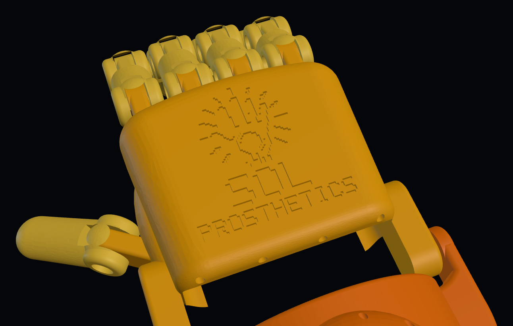
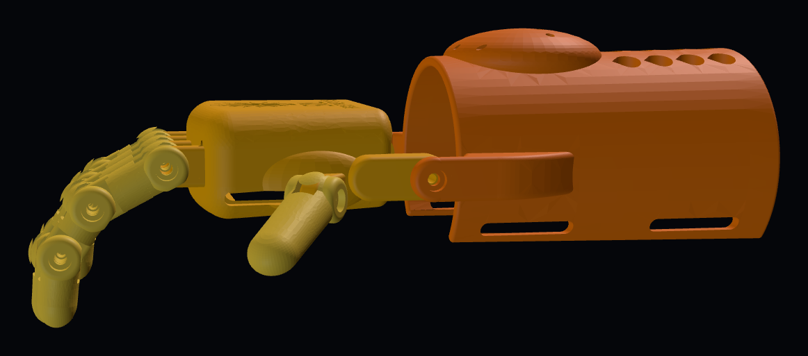

# Bukang-liwayway ("Sunrise"), Model 1, v2 test print

**Ages:** about 9 and under · **Status:** v2 test print (not yet fitted to a child) · **Updated:** 2026-10-18
**Designer:** Hoofie Puppet · **License:** CC BY-NC-SA 4.0 (see the repo's LICENSE)

A wrist-driven hand. When the child bends the wrist down, braided lines running under each finger pull the fingers closed. Bending the wrist back lets them open. The thumb is positionable: set its angle, then tighten its screw.

v2 keeps the v1 mechanism and hardware and gives every part an organic, human-like shape:

- **Fingers:** oval cross-sections that narrow between rounded knuckles, and domed fingertips. A smooth knuckle cap hides each joint's tongue and stops the fingers bending backwards.
- **Palm:** tapers toward the wrist, with a curved knuckle line (middle knuckles furthest forward), a thumb-side muscle pad, a softer little-finger side and rounded edges.
- **Logo:** the **Sol Prosthetics** logo and name pressed 0.8 mm into the back of the hand.
- **Line tunnels:** the flexor lines run through tunnels hidden inside the back of the palm. There are no open grooves.
- **Gauntlet:** tapers to the wrist, with a smooth tensioner bump in place of the angled block, curved wrist ears, teardrop vents, rounded slots, and rounded edges all round.

| | |
|---|---|
|  |  |

> **v2 is for test printing and checking the mechanism, at 100% only.** Don't scale these STLs in the slicer yet: the screw holes are sized for M3 and would come out wrong. Sized STLs from the Hand Sizer number come in a later version.

## Size at 100%

| Measurement | Value |
|---|---|
| Finger span across the knuckles | 61 mm |
| Wrist crease to middle fingertip | 122.5 mm |
| Cuff inside circumference | about 185 mm at the wrist end (tapers wider toward the elbow; open underside, strapped closed) |
| Palm | 66 mm wide at the knuckles, 58 mm at the wrist, 30 mm thick |

## Files

| File | Part | Print | Qty | Supports |
|---|---|---|---|---|
| `stl/SP1-01_palm_back-side-down.stl` | Palm | Back of the hand (logo side) on the bed, already turned | 1 | **Build plate only**, for the knuckle tongues, wrist ears, thumb mount and side bulges |
| `stl/SP1-02_finger-index-and-ring_print-x2.stl` | Index / ring finger (3 segments) | Flat, palm side down | **2** | None |
| `stl/SP1-02_finger-middle.stl` | Middle finger (3 segments) | Flat, palm side down | 1 | None |
| `stl/SP1-02_finger-little.stl` | Little finger (3 segments) | Flat, palm side down | 1 | None |
| `stl/SP1-06_thumb.stl` | Thumb | Flat, palm side down | 1 | None |
| `stl/SP1-03_gauntlet_stand-on-forearm-end.stl` | Gauntlet (forearm cuff) | Standing on the forearm end, already turned | 1 | None. Use a **brim** (tall part) |

Every STL is already turned to its print direction. The palm prints logo-side down, so the logo comes out crisp on the first layers.

**Print settings:** PETG (never PLA, it softens in the heat), 0.2 mm layers, 4 walls, 40% gyroid infill for the palm and fingers, 30% for the gauntlet. A 0.4 mm nozzle is assumed.

## Hardware

| Item | Qty | Use |
|---|---|---|
| M3 × 12 stainless screw | 13 | 12 finger joints (3 per finger) + 1 thumb |
| M3 × 8 stainless screw | 2 | Wrist hinge |
| M3 × 6 stainless screw | 4 | Line clamps in the tensioner bump |
| Braided fishing line, about 50 lb / 20 kg | about 2 m | 4 flexor lines |
| 1 mm round elastic cord | about 1.5 m | v2 return cord in the back channel of each finger |
| Hook-and-loop strap, sew-on, 25 mm | 2 | Gauntlet |
| Hook-and-loop strap, sew-on, 16 mm | 1 | Palm |
| Washable foam or mesh liner | 1 piece | Inside the cuff |
| A thin wire or long needle | 1 | For threading the lines through the tunnels |

## How the joints work

Every joint is the same: a **fork** on the outer segment and a **tongue** on the inner one. The M3 × 12 screw goes in from the side with the round recess (the head sits flush), passes through the tongue, and threads into the 2.6 mm hole in the far arm. There are no nuts. Tighten until the joint moves freely without wobble. The knuckle cap on top of each fork is also the stop that keeps the finger from bending backwards.

## Assembly (v2)

1. Clean every hole. Run an M3 screw through each joint hole once so the threads cut cleanly.
2. Build each finger: segment 1 (longest) onto the palm tongue, segment 2 onto segment 1, the fingertip onto segment 2.
3. Fit the thumb onto the angled tongue on the thumb side of the palm. Set the angle, then tighten.
4. Join the palm to the gauntlet at the wrist with the two M3 × 8 screws (gauntlet outside, palm inside).
5. Flexor lines: tie a knot at each fingertip and thread the line back through the **lower** channel of all three segments and the palm tongue. Inside the palm it climbs into a tunnel in the back of the hand and comes out at the wrist end. Use the wire or needle to pull it through.
6. Feed each line into its small hole in the front of the tensioner bump on the gauntlet. With the wrist straight and the fingers open, pull the line snug and screw in its M3 × 6 clamp screw from the top; the screw pins the line. Bend the wrist down and check that the fingers close. To adjust, loosen the screw, pull or let out a little line, and tighten again until all four fingers close together.
7. Return cords: thread elastic through the **upper** channel of each finger, knot it at the fingertip and anchor it on the back of the palm, just snug enough to open the finger again.
8. Sew the straps on, fit the liner, and sand any edge that touches skin.

## Notes and what to check on the test print

- **Return:** elastic cord for now (cheap and easy to swap). Printed TPU springs (SP1-05) and fingertip and palm pads (SP1-04) come in a later version, once the test print shows the real forces.
- **Check:** joint friction, how far the fingers curl when the wrist bends, whether the thumb meets the index and middle fingers, how the lines slide through the tunnels, and the cuff fit.
- **Tested in CAD:** no collisions with the fingers straight, with the fingers curled 45° at every joint (about 135° total), with the wrist bent down 35°, or with the wrist bent up 25°. Every part is a single valid solid.

## Source

- `cad/bukang_liwayway_v2.py` is the CadQuery model (the design source). Run `python3 bukang_liwayway_v2.py stl` to export these STLs.
- `cad/logo_rects.json` is the pressed-in logo, traced from the official logo: the emblem as filled shapes, the name in a 5 × 7 pixel font.
- v1 (the boxy first version, built in kernelCAD) is in the repository history.

## Change log

- 2026-10-18: v1 test print. Palm, 3-segment fingers, positionable thumb, gauntlet with wrist hinge and screw tensioner. M3 screw joints.
- 2026-10-18: v2. Organic shapes throughout (see above), logo pressed into the back of the hand, hidden line tunnels, knuckle caps with a hyperextension stop, tensioner bump with screw line clamps (M3 × 6), tapered gauntlet with rounded edges and teardrop vents.
