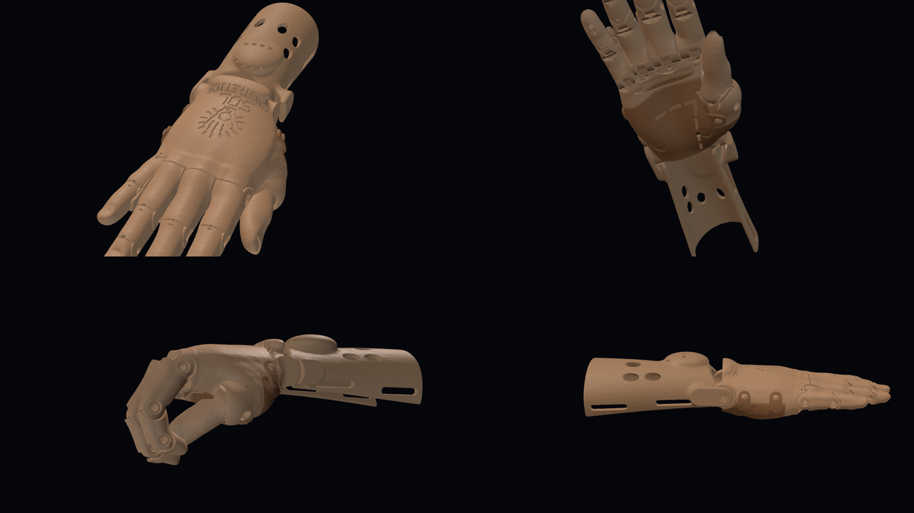
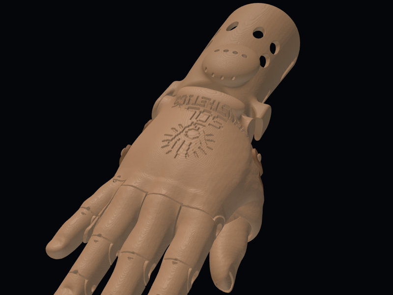
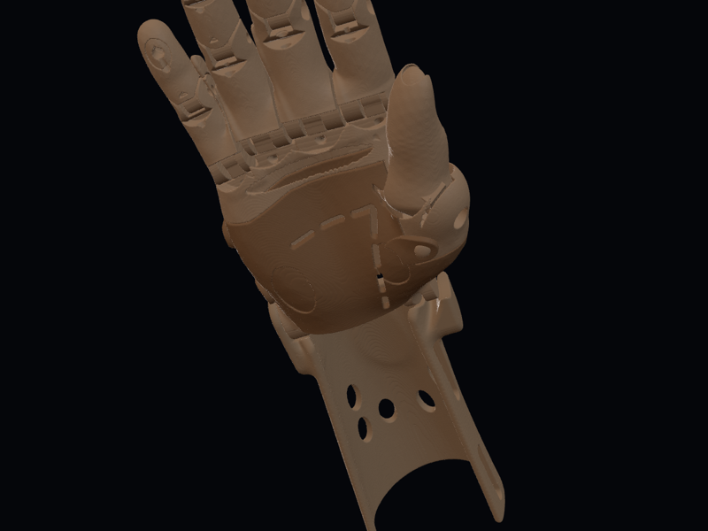
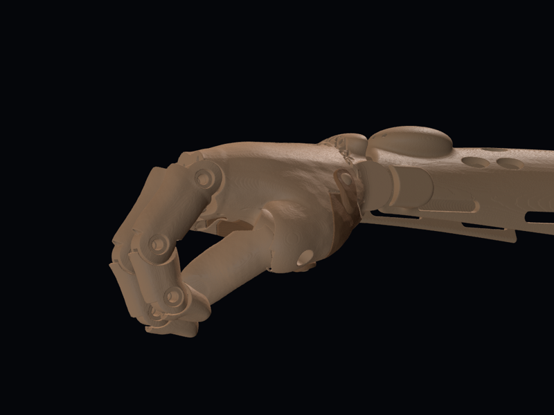
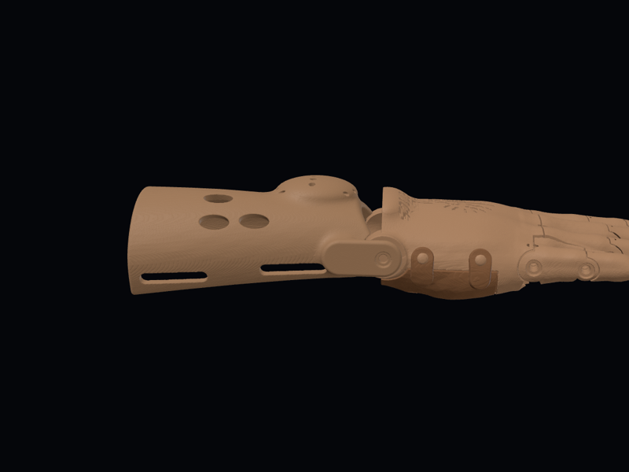

# Bukang-liwayway ("Sunrise") v3, realistic — test print

**Status:** v3 test print. It has not been printed or fitted to a child yet. · **Updated:** 2026-10-19
**Designer:** Hoofie Puppet · **License:** CC BY-NC-SA 4.0 (see the repo's LICENSE)

**Model 1, ages about 9 and under.**

This is a wrist-driven hand shaped from a real child's hand: a MakeHuman child model, smoothed and grown slightly so the shell is strong. Bending the wrist down pulls four braided lines, and the fingers close. Bending it back lets elastic cords open them again. The thumb sits on a friction hinge. You swing it to the grip you want and tighten one screw.

This is Model 1, Bukang-liwayway. The same realistic hand will be the starting point for Sinag (stronger grip and tensioner) and Tanghali (motor).

## What's new compared with v2

- **Realistic shape.** The fingers, nails, knuckles and palm come from a real child hand model. Every joint follows a real knuckle crease. On the back of the hand, the joints look like knuckles.
- **Closed, safer palm.** The back of the hand is rigid PETG. The palm side is a soft TPU flap. The flap tucks under the knuckles and buttons over four rounded knobs, like a watch band. There's no hinge, no latch, no pinch gap and no small part that can come loose. The child's hand goes in from the palm side, then the flap closes.
- **Grip.** There are shallow pockets for bicycle inner-tube rubber on all five fingertips and three palm pads. Each pocket has a small lip that holds the rubber in.
- **Vents and drain.** Short slots run along the natural palm creases, and a drain hole sits at the front of the hand cavity, so sweat and water can get out.
- **Hidden lines.** The flexor lines run through tunnels inside the back of the hand, and the return cords run inside the fingers. Nothing is strung on the outside.
- **Logo.** The **Sol Prosthetics** logo and name are pressed 0.8 mm into the back of the hand, following its curve.
- **Not fragile.** Every part is a single solid. The thin knife edges where joint cuts met the skin have been trimmed back to at least about 0.45 mm (one nozzle line), and edges are rounded. Every line tunnel has a rounded mouth so it can't fray the line.

| | |
|---|---|
|  |  |
|  |  |

> **Print at 100% only for now.** The screw holes are sized for M3 and come out wrong if you scale the STLs in the slicer. Sized sets from the Hand Sizer number come later.

## Size at 100%

| | |
|---|---|
| Child's hand the shape was made from | about 55 mm across the knuckles, 129 mm from wrist crease to middle fingertip |
| Wrist circumference (child) | about 97 mm, with a 1 mm liner gap inside the shell |
| Forearm circumference (child, mid-forearm) | about 110 mm, with a 1.5 mm liner gap inside the cuff |
| Child's palm length that fits | up to about **49 mm** from the wrist crease. The knuckle block in front of that holds the finger joints. |
| Finished hand | about 7 mm wider and 7–8 mm thicker than the child's hand (shell walls and liner) |

## Files (`stl/`, already turned to print direction)

| File | Part | Material | Qty | Supports |
|---|---|---|---|---|
| `palm_back.stl` | Back of the hand: knuckles, thumb mount, wrist ears, line tunnels, logo | PETG | 1 | Yes, from the build plate. It stands on the wrist end; use a brim. Supports never touch the logo. |
| `palm_flap.stl` | Palm-side flap: vents, rubber pockets, closure tabs | **TPU 95A** | 1 | Few |
| `thumb.stl` | Thumb with its hinge tongue and rubber pocket | PETG | 1 | Few |
| `finger-<name>-1/2/3.stl` | Finger segments (little finger has 2) | PETG | 1 of each (11) | Few |
| `cuff.stl` | Forearm cuff: tensioner bump, line clamps, strap slots, vents | PETG | 1 | Few |

**Print settings:** PETG (never PLA, it softens in the heat), 0.2 mm layers, 5 walls, 40–50% gyroid infill for the fingers, thumb and back, 30% for the cuff. TPU flap: slow (20–30 mm/s), little or no retraction, 3 walls, 30% infill, and **fuzzy skin** on the outside so the palm isn't slippery. A 0.4 mm nozzle is assumed.

## Hardware

| Item | Qty | Use |
|---|---|---|
| M3 × 12 stainless screw | 5 | Finger joints: index knuckle, middle knuckle and middle joint, ring middle joint (4), and the thumb hinge (1) |
| M3 × 10 stainless screw | 6 | Finger joints: index middle and tip joints, middle tip joint, ring knuckle and tip joint, little middle joint |
| M3 × 8 stainless screw | 1 | Little finger knuckle |
| M3 × 6 stainless screw | 6 | Wrist hinge (2) and line clamps in the tensioner bump (4) |
| Braided fishing line, about 50 lb / 20 kg | about 2 m | 4 flexor lines |
| 1 mm round elastic cord | about 1.5 m | 4 return cords |
| Bicycle inner tube | 1 small piece | Grip pads and the two thumb-hinge washers |
| Contact cement (e.g. Rugby) | a little, optional | Backup only, if a grip pad lifts |
| Hook-and-loop strap, sew-on, 25 mm | 2 | Cuff |
| Washable foam or mesh liner, about 1–1.5 mm | 1 piece | Inside the cuff and the back of the hand |

## How it goes together

1. **Clean the holes.** Run an M3 screw through every joint hole once to cut the threads. The far side of each joint is a 2.6 mm pilot hole, so the screw threads into the plastic and no nuts are needed.
2. **Fingers.** Every joint is a rounded barrel in a cup, held by one screw from the side. The head sits in a round recess. Tighten until the joint moves freely without wobble. A flat stop on the back of each joint keeps the finger from bending backwards.
3. **Fit the fingers to the palm in this order: middle, index, ring, little.** The index and middle knuckle screws go in from the thumb side. The ring and little screws go in from the little-finger side. Doing the middle finger first means every screw is still reachable.
4. **Thumb.** Put a small inner-tube washer on each side of the thumb tongue, fit it into the slotted barrel on the thumb mount, and screw in the M3 × 12. Swing the thumb to the grip position, then tighten until it holds there.
5. **Return cords (open the fingers).** Knot the elastic in the knot pocket under the fingertip rubber pad. Thread it through the upper channel of each segment and through the tunnel in the back of the hand. Knot it in the small counterbore on the wrist end of the back, just snug enough to open the finger.
6. **Flexor lines (close the fingers).** Knot each line in the same fingertip pocket. Thread it through the lower channel of each segment, into the knuckle block and through its tunnel to the wrist end. A thin wire or long needle helps.
7. **Wrist.** Join the back of the hand to the cuff with the two M3 × 6 screws through the cuff's ear plates.
8. **Tensioner.** Feed each line into its channel in the front of the tensioner bump. With the wrist straight and the fingers open, pull it snug and screw in its M3 × 6 clamp screw from the top; the screw pins the line. Bend the wrist down and check that the fingers close. Adjust each line until all four close together.
9. **Grip pads.** Cut inner-tube rubber to the pocket sizes below and tuck its edges under the pocket lip; the lip holds it. If a pad still lifts, wipe it with alcohol and add a thin film of contact cement as a backup.
10. **Palm flap.** Slide the flap's front tongue into the slot under the knuckles, then stretch each of the four tabs over its knob.
11. **Straps and liner.** Sew the straps on, fit the liner, and sand any edge that touches skin.

**Grip pad sizes (cut the rubber to this, so it tucks under the lip):** fingertips 7 × 9 mm ovals (4), thumb tip 11 × 8 mm, little-finger side of the palm 20 × 12 mm, thumb side of the palm 16 × 10 mm, under the knuckles 38 × 7 mm.

## Putting it on and caring for it

- Open the flap, slide the hand in from the palm side, close the flap, then do up the cuff straps.
- **Check the child's skin every day,** especially in the heat. A closed shell hides red marks and pressure spots. If you see a mark that doesn't fade within about 20 minutes, stop using the hand until it has been checked.
- Wash the flap, liner and shell with soap and water, and let them drain and dry. The vents and drain let water out.
- If you can, fit the first few hands with a physical therapist or prosthetist. Every residual limb is different.

## Tested in CAD

- **Fingers:** no collisions between any parts with the fingers straight, at 30° per joint and at 60° per joint. The stop catches the finger just past straight.
- **Wrist:** the hand swings from 40° down to 25° up with no collisions.
- **Closing:** with the wrist bent down 30°, the fingers close about 40° per joint. At 40° down they close about 55° per joint, and the little finger closes about 68°.
- **Pinch:** the thumb meets the index fingertip at about 52° per finger joint, with the wrist bent down about 37°. The middle finger closes alongside it, about 3 mm short. Swing the thumb a little further on its hinge for a tighter pinch.
- **Thumb hinge:** clear of the palm along its whole 72° swing.
- **Print checks:** every STL is one closed, watertight solid with no non-manifold edges. Line tunnels have about 0.9 mm of wall or more (95% of their length). Less than 0.4% of any part's surface is thinner than 0.45 mm, all at small rounded edges.

**On the test print, check:** joint friction, how far the fingers close as the wrist bends, the pinch, how the lines slide, how the flap tabs feel after many openings, and the fit inside the cavity.

## Source (`cad/`)

The hand is generated from the MakeHuman model by Python scripts (trimesh, manifold3d, scikit-image, scipy, shapely, embreex). Run `build_all.sh` to rebuild everything and run the checks.

| Script | Step |
|---|---|
| `extract.py` | Cuts the right arm out of the MakeHuman body and turns it into the hand frame |
| `skin.py` | Outer skin and child cavity |
| `thumb_solve.py` | Thumb pinch pose and hinge axis |
| `fingers.py`, `joints.py` | Finger segments, joints, channels, palm knuckles |
| `palm.py` | Back of the hand, TPU flap, thumb |
| `cuff.py` | Forearm cuff |
| `mouths.py`, `open_parts.py` | Round the tunnel mouths and trim knife edges |
| `orient.py`, `clean_stl.py` | Print orientation and clean STLs |
| `check_*.py` | The checks above |

`src/right-arm-oriented.stl` is the extracted arm, so the build can run without the full MakeHuman body. `src/logo_rects.json` is the pressed-in logo pattern.

## Change log

- 2026-10-18: v1 test print (boxy, kernelCAD) and v2 (organic CadQuery shapes). Both are superseded and removed; they are in the git history.
- 2026-10-19: v3, realistic hand. Shape from a MakeHuman child hand. Barrel joints follow the knuckle creases. Closed palm with a PETG back and a TPU flap closed by a tuck tongue and four tabs. Rubber grip pockets, crease vents and a drain. Hidden line tunnels and return cords. Logo on the curved back. Thumb on a friction hinge set by one screw. Knife edges trimmed and tunnel mouths rounded.
