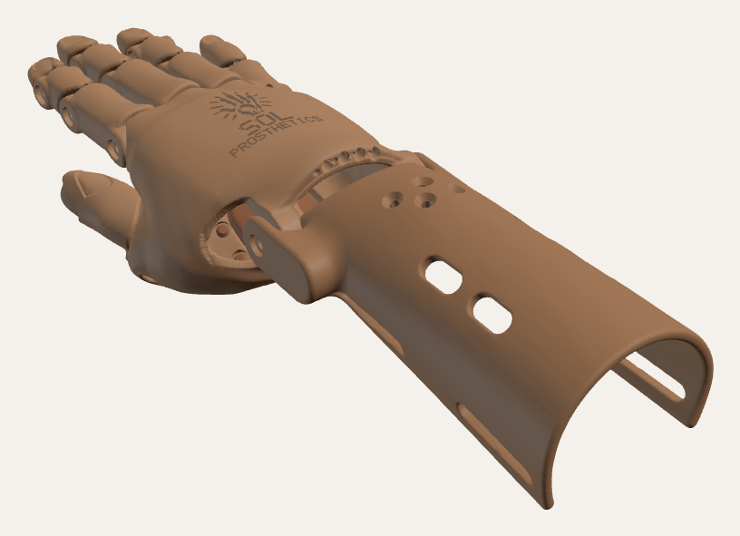
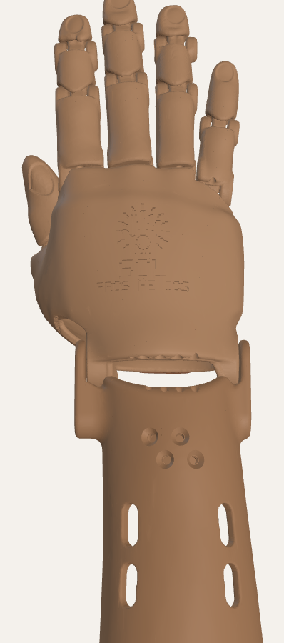
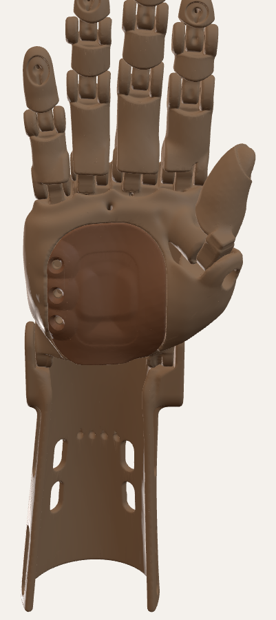
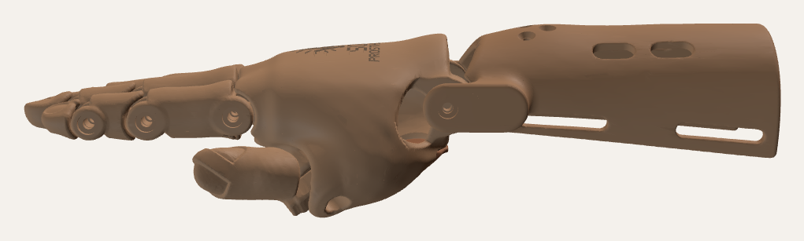
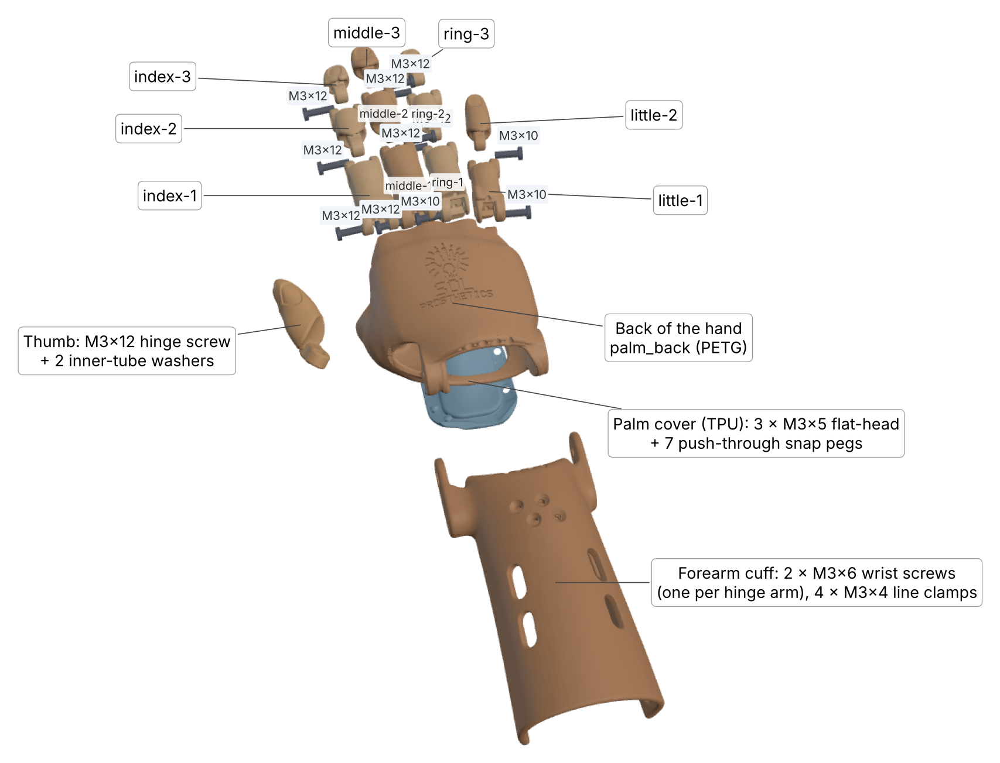

# Bukang-liwayway ("Sunrise") v3.1, realistic — test print

**Status:** v3.1g test print. It has not been printed or fitted to a child yet. · **Updated:** 2026-10-24
**Designer:** Hoofie Puppet · **License:** CC BY-NC-SA 4.0 (see the repo's LICENSE)

**Model 1, ages about 9 and under.**

This is a wrist-driven hand shaped from a real child's hand: a MakeHuman child model, smoothed and grown slightly so the shell is strong. Bending the wrist down pulls four braided lines, and the fingers close. Bending it back lets elastic cords open them again. The thumb sits on a friction hinge. You swing it to the grip you want and tighten one screw.

This is Model 1, Bukang-liwayway. The same realistic hand will be the starting point for Sinag (stronger grip and tensioner) and Tanghali (motor).

## What's new compared with v2

- **Realistic shape.** The fingers, nails, knuckles and palm come from a real child hand model. Every joint follows a real knuckle crease. On the back of the hand, the joints look like knuckles.
- **Closed, safer palm.** The back of the hand is rigid PETG. The palm side is a thin (about 2 mm) TPU cover with a clean surface and a gently raised oval grip area in the middle. Its edge is one even 6 mm lip that lies flush in a matching step all the way round the opening, so there are no gaps and nothing sticks out. Three flush M3 × 5 countersunk screws hold the little-finger edge (the TPU bends there like a hinge); everywhere else 7 TPU snap pegs under the lip push through holes in the step and their mushroom heads pop out into small recesses on the inside (flush, nothing to feel). The child's hand goes in from the palm side, then the cover is pressed shut.
- **Grip.** The five fingertips have shallow 1 mm recesses for bicycle inner-tube rubber, glued in with contact cement. The palm grips with the raised oval of the TPU cover (print it with fuzzy skin).
- **Drain.** A drain hole at the front of the hand cavity lets sweat and water out.
- **Hidden lines.** The flexor lines run through tunnels inside the back of the hand, and the return cords run inside the fingers. Nothing is strung on the outside. Channels are 1.5 mm (flexor line) and 1.6 mm (return cord in the fingers), 1.5 mm in the back of the hand and 1.8 mm in the cuff tensioner, and every channel exit is a smooth rounded flare.
- **Logo.** The **Sol Prosthetics** logo and name are pressed 0.8 mm into the back of the hand, following its curve.
- **Not fragile.** Every part is a single solid. The thin knife edges where joint cuts met the skin have been trimmed back to at least about 0.45 mm (one nozzle line), and edges are rounded. Every line tunnel has a rounded mouth so it can't fray the line.

| | |
|---|---|
|  |  |
|  |  |

> **Print at 100% only for now.** The screw holes are sized for M3 and come out wrong if you scale the STLs in the slicer. Sized sets from the Hand Sizer number come later.

## Guides

- [Printing and assembly guide (PDF)](printing-and-assembly-guide.pdf): parts, print settings, hardware, tools, step-by-step assembly, tuning and care.
- [Illustrated assembly and stringing guide (PDF)](assembly-and-stringing-illustrated.pdf): exploded view, which screw goes where, the stringing map and a cut-through of one finger.

## Size at 100%

| | |
|---|---|
| Child's hand the shape was made from | about 55 mm across the knuckles, 129 mm from wrist crease to middle fingertip |
| Wrist circumference (child) | about 97 mm, with a 1 mm liner gap inside the shell |
| Forearm circumference (child, mid-forearm) | about 110 mm, with a 1.5 mm liner gap inside the cuff |
| Child's palm length that fits | up to about **49 mm** from the wrist crease. The knuckle block in front of that holds the finger joints. |
| Finished hand | about 7 mm wider and 7–8 mm thicker than the child's hand (shell walls and liner) |

## Files (`stl/`, already turned to print direction)

| File | Part | Material | Qty | Supports |
|---|---|---|---|---|
| `palm_back.stl` | Back of the hand: knuckles, thumb mount, wrist ears, line tunnels, logo, step for the cover | PETG | 1 | Yes, from the build plate. It stands on the wrist end; use a brim. Supports never touch the logo. |
| `palm_flap.stl` | Palm cover: raised grip oval, flush edge lip with 7 push-through snap pegs, screwed hinge edge | **TPU 95A** | 1 | Few |
| `thumb.stl` | Thumb with its hinge tongue and rubber pocket | PETG | 1 | Few |
| `finger-<name>-1/2/3.stl` | Finger segments (little finger has 2); the tip segments have a shallow fingernail you can paint | PETG | 1 of each (11) | Few |
| `cuff.stl` | Forearm cuff: low tensioner swelling with flush line clamps, strap slots, vents | PETG | 1 | Few |

**Print settings:** PETG (never PLA, it softens in the heat), 0.2 mm layers, 5 walls, 40–50% gyroid infill for the fingers, thumb and back, 30% for the cuff. TPU flap: slow (20–30 mm/s), little or no retraction, 3 walls, 30% infill, and **fuzzy skin** on the outside so the palm isn't slippery. A 0.4 mm nozzle is assumed.

## Hardware

| Item | Qty | Use |
|---|---|---|
| M3 × 12 stainless **button-head** screw (ISO 7380) | 9 | Index, middle: knuckle, middle and tip joints; ring: middle and tip joints; thumb hinge |
| M3 × 10 stainless button-head screw | 3 | Ring knuckle; little finger knuckle and tip joint |
| M3 × 6 stainless screw | 2 | Wrist hinge (one through each cuff arm into the hand's ear pad) |
| M3 × 4 stainless **countersunk (flat-head)** screw | 4 | Line clamps in the tensioner swelling; they sit flush |
| M3 × 5 stainless **countersunk (flat-head)** screw | 3 | The palm cover's hinge edge; they sit flush |
| Braided fishing line, about 50 lb / 20 kg | about 2 m | 4 flexor lines |
| 1 mm round elastic cord | about 1.5 m | 4 return cords |
| Bicycle inner tube | 1 small piece | Grip pads and the two thumb-hinge washers |
| Contact cement (e.g. Rugby) | a little | Gluing the grip pads into their recesses |
| Hook-and-loop strap, sew-on, 25 mm | 2 | Cuff |
| Washable foam or mesh liner, about 1–1.5 mm | 1 piece | Inside the cuff and the back of the hand |

## How it goes together

1. **Clean the holes.** Run an M3 screw through every joint hole once to cut the threads. Every joint hole goes all the way through. The far side is a 2.6 mm pilot hole, so the screw threads into the plastic and no nuts are needed.
2. **Fingers.** Every joint is a rounded barrel in a cup, held by one button-head screw from the side. The head sits flush in a round recess (that side is the head side); the far side has a through pilot hole (the screw is shorter than the joint, so nothing pokes out). Tighten until the joint moves freely without wobble. A flat stop on the back of each joint keeps the finger from bending backwards.
3. **Fit the fingers to the palm in this order: middle, index, ring, little.** Each screw goes in from the side with the round recess. Doing the middle finger first means every screw is still reachable.
4. **Thumb.** Put a small inner-tube washer on each side of the thumb tongue, fit it into the slotted barrel on the thumb mount, and screw in the M3 × 12. Swing the thumb to the grip position, then tighten until it holds there.
5. **Return cords (open the fingers).** Knot the elastic in the knot pocket under the fingertip rubber pad. Thread it through the upper channel of each segment and through the tunnel in the back of the hand. Knot it in the small counterbore on the wrist end of the back, just snug enough to open the finger.
6. **Flexor lines (close the fingers).** Knot each line in the same fingertip pocket. Thread it through the lower channel of each segment, into the knuckle block and through its tunnel to the wrist end. A thin wire or long needle helps.
7. **Wrist.** Join the back of the hand to the cuff with the two M3 × 6 screws through the cuff's ear plates.
8. **Tensioner.** Feed each line into its hole in the front end of the cuff. It runs inside the wall, under its clamp, and comes out on the inside of the cuff behind the swelling; trim the tail there. With the wrist straight and the fingers open, pull it snug and screw in its M3 × 4 flat-head clamp screw from the top until it sits flush; the screw pins the line. Bend the wrist down and check that the fingers close. Adjust each line until all four close together.
9. **Grip pads.** Cut inner-tube rubber to the recess sizes below. Wipe the recess and the rubber with alcohol, put a thin film of contact cement on both, let it go tacky (about 10 minutes), then press the pad in firmly.
10. **Palm cover.** Lay the cover's little-finger edge in its step on the back and fit the three M3 × 5 flat-head screws from outside until they sit flush. Don't overtighten; the TPU only needs to be held. Fold the cover shut and press firmly over each snap peg until its head pops through the hole in the step (you'll feel it click). To open it again, peel the edge back firmly; the TPU heads squeeze back through.
11. **Straps and liner.** Sew the straps on, fit the liner, and sand any edge that touches skin.

**Grip pad sizes (cut the rubber to this):** fingertips 7 mm wide ovals: index 7 × 6.5, middle 7 × 7, ring 7 × 6.5, little 7 × 9 mm, thumb tip 11 × 8 mm.

## Putting it on and caring for it

- Unsnap the cover from the thumb side (it stays screwed on the little-finger side), slide the hand in from the palm side, press the cover shut, then do up the cuff straps.
- **Check the child's skin every day,** especially in the heat. A closed shell hides red marks and pressure spots. If you see a mark that doesn't fade within about 20 minutes, stop using the hand until it has been checked.
- Wash the cover, liner and shell with soap and water, and let them drain and dry. The drain lets water out.
- If you can, fit the first few hands with a physical therapist or prosthetist. Every residual limb is different.

## Tested in CAD

- **Fingers:** no collisions between any parts with the fingers straight, at 30° per joint and at 60° per joint. The stop catches the finger just past straight.
- **Wrist:** the hand swings from 55° down to 25° up with no collisions.
- **Closing:** with the wrist bent down 40°, the fingers close about 43–48° per joint (little finger about 67°). At 50° down they close about 54–60° per joint.
- **Pinch:** the thumb meets the index fingertip at about 52° per finger joint, with the wrist bent down about 48°. The middle finger closes alongside it, about 2.5 mm short. Swing the thumb a little further on its hinge for an earlier, tighter pinch.
- **Thumb hinge:** clear of the palm along its whole 72° swing.
- **Print checks:** every STL is one closed, watertight solid with no non-manifold edges. Line tunnels have about 0.9 mm of wall or more over 95% of their length. Under 1% of any part's surface is thinner than 0.45 mm.

**On the test print, check:** joint friction, how far the fingers close as the wrist bends, the pinch, how the lines slide, how the cover snaps feel after many openings, and the fit inside the cavity.

## Source (`cad/`)

The hand is generated from the MakeHuman model by Python scripts (trimesh, manifold3d, scikit-image, scipy, shapely, embreex). Run `build_all.sh` to rebuild everything and run the checks.

| Script | Step |
|---|---|
| `extract.py` | Cuts the right arm out of the MakeHuman body and turns it into the hand frame |
| `skin.py` | Outer skin and child cavity |
| `thumb_solve.py` | Thumb pinch pose and hinge axis |
| `fingers2.py` (+ `fingers.py`, `joints.py`, `fingerskin.py`) | Finger segments: filleted barrel joints, screw holes, line channels, fingertip recesses and nails |
| `palm2.py` (+ `palm.py`, `cavity.py`) | Back of the hand, TPU palm cover with its snap pegs, thumb |
| `cuff2.py` | Forearm cuff with the tensioner swelling, line channels and clamps |
| `sdf.py`, `sdfparts.py`, `lib_grid.py`, `rlib.py` | Smooth-shape (distance field) helpers |
| `orient.py`, `clean_stl.py` | Print orientation and clean STLs |
| `check_*.py` | The checks above |

`src/right-arm-oriented.stl` is the extracted arm, so the build can run without the full MakeHuman body. `src/logo_rects.json` is the pressed-in logo pattern.

## Change log

- 2026-10-18: v1 test print (boxy, kernelCAD) and v2 (organic CadQuery shapes). Both are superseded and removed; they are in the git history.
- 2026-10-19: v3, realistic hand. Shape from a MakeHuman child hand. Barrel joints follow the knuckle creases. Closed palm with a PETG back and a TPU flap closed by a tuck tongue and four tabs. Rubber grip pockets, crease vents and a drain. Hidden line tunnels and return cords. Logo on the curved back. Thumb on a friction hinge set by one screw. Knife edges trimmed and tunnel mouths rounded.
- 2026-10-19: v3.1. Every part rebuilt as smooth shapes: polished skin (no lumps or crease), rounded seams and edges, filleted tongues, barrels and knobs, no knife edges or thin rims, stray webs removed at the knuckle/thumb junction. Flap: straight rounded thumb-side edge, six knob tabs (tuck tongue removed). Cuff: tensioner is now a low, symmetric swelling (2.8 mm) centred on the forearm, clamps are flush M3 × 4 flat-head screws, rounded strap slots and vents, wrist clearance to 55° down. Back of the hand: logo centred and moved clear of the wrist end (34 mm), separate line hump replaced by a broad low swelling, surfaces polished.
- 2026-10-23: v3.1c. Flap closure redesigned: no knobs; the flap's edge lies flush in a recessed step, screwed on the little-finger side (3 × M3 × 4 flat-head) and closed with thin hook-and-loop elsewhere. Every line channel and tunnel is now cut into the smooth shape, so each exit is a rounded flare (no distorted holes); channels enlarged to 1.5–1.8 mm. Joints strengthened: 2.6 mm or more of plastic under every screw head, heads flush, blind pilot holes, thicker tongue rings, thin hoods trimmed. Final rounding pass on every part (nothing thinner than about 1.2 mm), shell walls round the cavity at least about 2.5 mm, separate vent slots, grip pads glued into plain recesses. Later the same day: thumb hinge eye joined to the thumb by a long filleted neck; cuff line channels follow the thick part of the tensioner wall and turn out through flared mouths; cuff clamp countersinks corrected (they were cut upside down); strands, ropes and thin fins removed from the back (nothing under 1.8 mm) and flap (nothing under 1.4 mm); flap laps simplified to clean rounded areas; vents kept 4 mm inside the flap's edge.
- 2026-10-23 (evening): v3.1e. Palm side redone: thin TPU cover with one even flush lip all round, 3 hinge screws on the little-finger side and snap bumps elsewhere (no hook-and-loop, no vents or pad pockets on the cover; raised oval grip instead); no seam swelling. Fixed: MCP tongue screw bores (were missing), wrist ear pilot holes (were 4.75 mm off the axis), cuff thumb-side hinge arm (was cut away), cuff vents (single slots), jagged fingertip recess rims. Logo smaller and nearer the knuckles.
- 2026-10-24: v3.1f. Cover opening made symmetric with an even step all round; cover is one clean piece (stray loops at its edge removed) with its 3 hinge screws, now M3 × 5. Knuckle tongue bores round and clean. Thumb-mount hole on the back closed. Cuff arms trimmed to the hand's swing so nothing sticks out; cuff lines enter at the front end and leave inside the cuff, so only the four clamp seats show on top (now staggered, each a separate round seat). Every finger joint hole goes all the way through. Shallow fingernails on every fingertip and the thumb.
- 2026-10-24 (later): v3.1g. Screw list corrected (9 × M3×12, 3 × M3×10, no M3×8). Cover snaps are now bigger push-through pegs (3 mm shaft, 4 mm mushroom head) that lock in recesses on the inside of the step. Knuckle screw holes fixed: each hole was drilled endlessly and cut a second, off-centre hole through the neighbouring knuckles; now each stops at its own knuckle, with a clean round ring round it.
