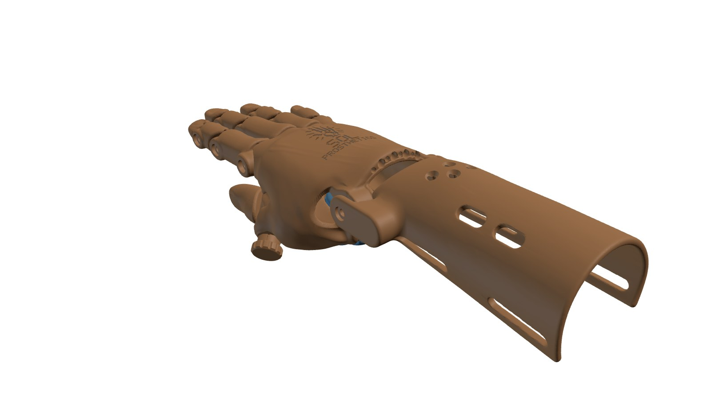
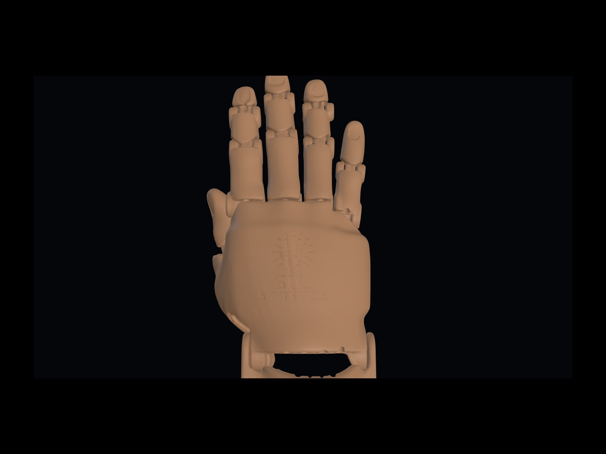
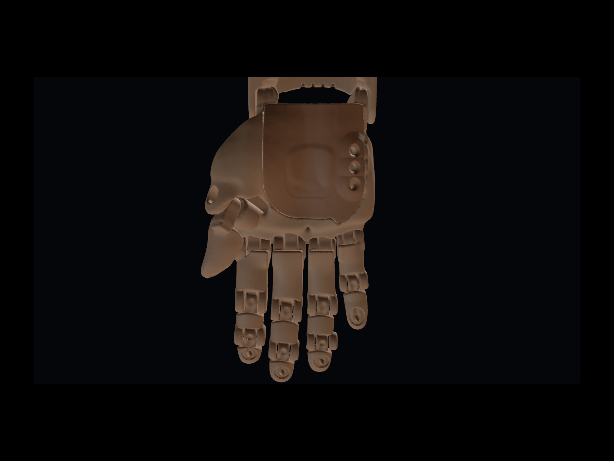
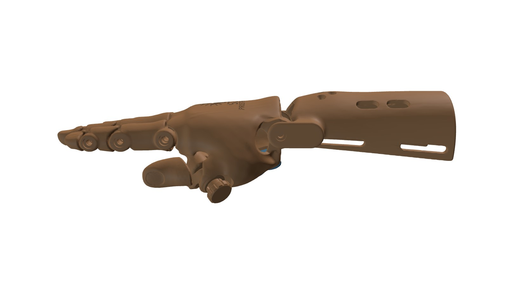
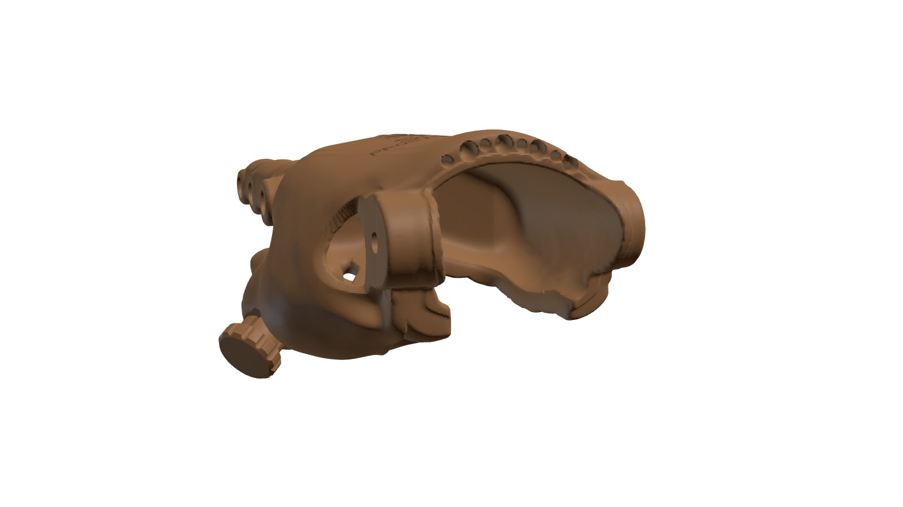
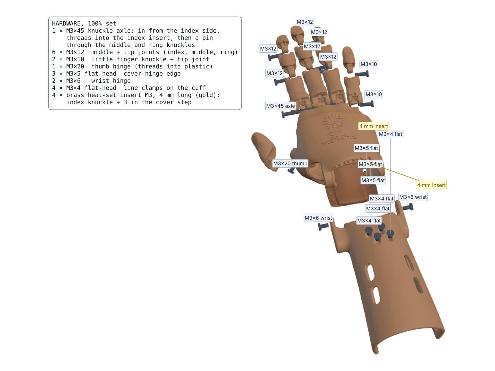
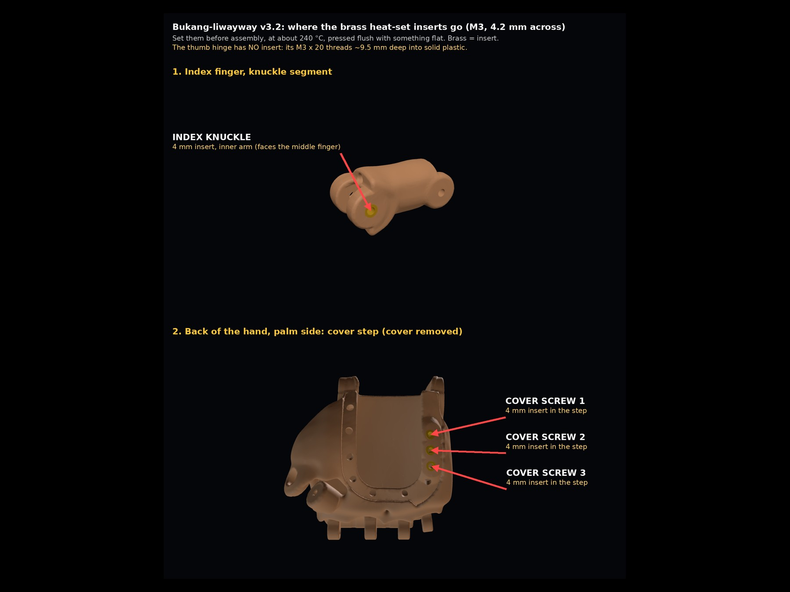

# Bukang-liwayway ("Sunrise") v3.2, realistic — test print

**Status:** v3.2 test print. It has not been fitted to a child yet. · **Updated:** 2026-10-25
**Designer:** Hoofie Puppet · **License:** CC BY-NC-SA 4.0 (see the repo's LICENSE)

**Model 1, ages about 9 and under.**

This is a wrist-driven hand shaped from a real child's hand: a MakeHuman child model, smoothed and grown slightly so the shell is strong. Bending the wrist down pulls four braided lines, and the fingers close. Bending it back lets elastic cords open them again. The thumb sits on a friction hinge. You swing it to the grip you want and tighten one screw.

This is Model 1, Bukang-liwayway. The same realistic hand will be the starting point for Sinag (stronger grip and tensioner) and Tanghali (motor).

## What changed in v3.2 (after the first full print, v3.1g)

| Fix | What it does |
|---|---|
| Knuckles | One long **M3 × 45 axle** goes in from the index side through the index, middle and ring knuckles. Separate screws there were impossible to put in between the fingers. The little finger keeps its own screw. |
| Open wrist end | The palm side now opens right out through the wrist end (a U, like the cuff), so the hand can actually go in. The soft cover closes it down to the wrist. Every opened edge is rounded so nothing pokes. |
| Line holes | Much bigger: 2.5 mm along the fingers, 2 mm at the joints with 3 mm funnel mouths, 2 mm tunnels in the back of the hand, 3 mm in the cuff (2 mm at its thin front end). The old 1.5 mm holes printed too small to thread. |
| Thumb | The hinge screw is now an **M3 × 20** that threads about 10 mm deep into solid plastic (it had only 2–3 mm and came loose). Natural thumbnail and pad, flush at the nail's free edge. |
| Heat-set inserts | Brass M3 inserts where the plastic is thick enough: the index knuckle and the 3 cover screws. |
| Cover | Screw holes centred on a wider (9.4 mm) hinge edge, 7 snap pegs, the corner near the wrist ears fixed, and a print version with snip-off supports and a sole bar built in. |
| Cuff | Trimmed separately to the back of the hand and to the cover so nothing rubs from 55° down to 30° up; smooth edges, round line entry holes. |
| Printing | Fingers and thumb print standing at 45° (nail side up), so no support scars on the visible faces. Every STL is already turned to its print direction. |

| | |
|---|---|
|  |  |
|  |  |
|  |  |

> **Print at 100% only for now.** Never scale the STLs in the slicer: the screw holes, insert pockets and joint gaps would change size. Ready-made size sets, each with its own hardware card, come after the test fit.

## Guides

Both PDF guides describe **v3.2**. For a size other than 100%, use the screw and insert list in that size's [`stl/HARDWARE.md`](stl/HARDWARE.md). The line routing is the same, but for v3.2 use the hardware list below, [`stl/HARDWARE.md`](stl/HARDWARE.md) and the two pictures above for screws and inserts. Updated guides come after the test print.

- [Printing and assembly guide (PDF, v3.2)](printing-and-assembly-guide.pdf)
- [Illustrated printing, assembly and stringing guide (PDF, v3.2)](assembly-and-stringing-illustrated.pdf)

## Size at 100%

| | |
|---|---|
| Child's hand the shape was made from | about 55 mm across the knuckles, 129 mm from wrist crease to middle fingertip |
| Wrist circumference (child) | about 97 mm, with a 1 mm liner gap inside the shell |
| Forearm circumference (child, mid-forearm) | about 110 mm, with a 1.5 mm liner gap inside the cuff |
| Child's palm length that fits | up to about **49 mm** from the wrist crease. The knuckle block in front of that holds the finger joints. |
| Finished hand | about 7 mm wider and 7–8 mm thicker than the child's hand (shell walls and liner) |

> [!CAUTION]
> **Always wear eye protection** when building or finishing the parts. Snipping supports and necks, drilling, trimming and cutting line can flick sharp bits of plastic into your eyes. The soldering iron for the inserts runs at about 240 °C: keep it in its stand and never leave it on alone. Print, set inserts and glue (E6000) in a room with fresh air. Keep cutters, the iron and loose screws away from small children: small parts are a choking risk.

> **Small parts, fiddly steps.** Many parts are small and need careful finishing: snipping supports, hand-drilling holes, setting hot brass inserts, threading thin line and tightening small screws. If you're building the hand for yourself (a teenager printing their own, say) and your grip or fine finger control is limited, ask someone to help with those steps. Children should always have an adult for the soldering iron and the cutters.

## Files (`stl/`, already turned to print direction)

| File | Part | Material | Qty | Supports |
|---|---|---|---|---|
| `palm_back_print.stl` | **Print this one:** the back of the hand (knuckles, thumb mount, wrist ears, line tunnels, logo, step for the cover) with a snip-off support under the wrist-end rim built in | PETG | 1 | Yes, normal supports, **with the blocker below**; 5 mm brim |
| `palm_back_print_support_blocker.stl` | Support blocker for `palm_back_print.stl`: keeps the slicer's supports out of every hole, line tunnel and the rim. Same coordinates as the part, load the two together | — | — | — |
| `palm_back.stl` | The same back of the hand without the print aids (for reference) | PETG | — | — |
| `palm_flap_print.stl` | **Print this one:** the TPU palm cover with snip-off support fins and a 0.6 mm sole bar built in. Snip the small tabs afterwards with flush cutters and shave any nub flush | **TPU 95A** | 1 | Normal supports on the build plate only (under the snap pegs) |
| `palm_flap.stl` | The same cover without the print aids (for reference) | TPU 95A | — | — |
| `thumb.stl` | Thumb with its hinge tongue, pad and nail | PETG | 1 | Yes, **on the build plate only**; stands at 45°, with a brim |
| `finger-<name>-1/2/3.stl` | Finger segments (little finger has 2); tip segments have a nail you can paint | PETG | 1 of each (11) | Yes, **on the build plate only**; stand at 45°, nail side up, with a brim |
| `cuff.stl` | Forearm cuff: low tensioner swelling with flush line clamps, strap slots, vents | PETG | 1 | Few |
| `HARDWARE.md` | Hardware card for this size: every screw and insert | — | — | — |

**Print settings:** PETG (never PLA, it softens in the heat), 0.4 mm nozzle, 0.2 mm layers, 5 walls, 40–50% gyroid infill for the fingers, thumb and back, 30% for the cuff. TPU cover: slow (20–30 mm/s), little or no retraction, 4 walls (so the 3 mm snap pegs print solid), 4 top and 4 bottom layers, 30% gyroid, 5 mm brim, and **fuzzy skin on the outer grip face only**. Keep fuzzy skin off the snap pegs: it adds about 0.3 mm and they jam in their holes.

### Supports

- **Screw holes never need support.** Every screw hole prints lying sideways and is small (2.6–3.4 mm, with 6.2 mm head recesses), so each layer only bridges a few millimetres over the top of the hole.
- **Fingers and thumb:** supports **on the build plate only**. All the support the slicer wants inside the screw holes would stand on the part itself, so this removes it; the supports that start on the bed under the low knuckle end stay.
- **Back of the hand:** it stands on its wrist end, so the line tunnels run almost straight up and need no support, but it touches the bed only under the two wrist ears, and the rim across the back of the hand floats about 8 mm up, right where the line tunnels come out. Print `palm_back_print.stl`: 14 small posts on a thin sole hold that rim, each joined by a 0.8 mm neck on solid plastic between the tunnel exits (never in a hole), and the sole gives the part about 450 mm² on the bed instead of about 6. Keep normal supports on (the inside of the knuckles and the underside of the thumb mount still need them) and load `palm_back_print_support_blocker.stl` with it:
  - **Creality Print / OrcaSlicer / PrusaSlicer:** drag both files in together and answer **Yes** to loading them as one object with multiple parts. Right-click the blocker part → **Change type → Support blocker**.
  - **Cura:** turn off "Automatically drop models to the build plate" and "Ensure models are kept apart" before loading, so both keep their positions. Select the blocker → **Per Model Settings** → **Don't support overlaps**.
- **After printing the back:** snip each neck flush at the rim with flush cutters, lift the support off and sand the 14 marks smooth. Check that every tunnel exit on the rim is clear before threading.

## Hardware

| Item | Qty | Use |
|---|---|---|
| M3 × 45 stainless **button-head** screw | 1 | Knuckle axle: in from the index side through the index, middle and ring knuckles |
| M3 × 12 stainless button-head screw | 6 | Middle and tip joints of the index, middle and ring fingers |
| M3 × 10 stainless button-head screw | 2 | Little finger knuckle and tip joint |
| M3 × 20 stainless button-head screw | 1 | Thumb hinge (threads straight into the plastic, no insert) |
| M3 × 6 stainless screw | 2 | Wrist hinge (one through each cuff arm into the hand's ear pad) |
| M3 × 4 stainless **countersunk (flat-head)** screw | 4 | Line clamps in the tensioner swelling; they sit flush |
| M3 × 5 stainless countersunk (flat-head) screw | 3 | The palm cover's hinge edge; they sit flush |
| M3 brass **heat-set insert**, 4.2 mm across × 4 mm long (double-knurled) | 4 | Index knuckle inner arm (faces the middle finger); 3 in the cover step |
| PE braided fishing line #4, 50 lb (about 0.32 mm) | about 2 m | 4 flexor lines |
| 1 mm round elastic cord | about 1.5 m | 4 return cords |
| Bicycle inner tube, about 1 mm | 1 small piece | Grip pads and the two thumb-hinge washers |
| E6000 or contact cement | a little | Gluing the grip pads |
| Hook-and-loop strap, sew-on, 25 mm | 2 | Cuff |
| Washable foam or mesh liner, about 1–1.5 mm | 1 piece | Inside the cuff and the back of the hand |

One 2 mm hex key fits every button-head screw.

## How it goes together

1. **Set the inserts.** Soldering iron at about 240 °C for PETG. Let the iron's weight push each insert in, then press it flush with something flat and cool. One goes in the index knuckle segment's inner arm (the side that faces the middle finger), three go in the cover step on the little-finger edge of the back. The thumb has **no** insert.
2. **Clean the holes.** The tops of holes printed without support can sag 0.1–0.2 mm. By hand, run a 3.5 mm drill bit through the 3.4 mm holes the screws slide through (finger joints, knuckle axle, thumb). **Don't drill the 2.6 mm pilot holes** the screws thread into: that would loosen the grip. Then run an M3 screw through every joint hole once. Every joint hole goes all the way through.
3. **Fingers.** Every middle and tip joint is a rounded barrel in a cup, held by one button-head screw from the side; the head sits flush in its round recess and the screw threads into the far side. Tighten until the joint moves freely without wobble.
4. **Knuckle axle.** Line up the index, middle and ring knuckles on the back of the hand and push the M3 × 45 in from the index side, through all three, and screw it into the index insert until its head sits in the recess. The little finger's knuckle has its own M3 × 10.
5. **Thumb.** Put a small inner-tube washer on each side of the thumb tongue, fit it into the thumb mount, and screw in the M3 × 20. Swing the thumb to the grip position, then tighten until it holds there.
6. **Return cords (open the fingers).** Knot the elastic in the knot pocket under the fingertip pad. Thread it through the upper channel of each segment and through its tunnel in the back of the hand. Knot it at the wrist end, just snug enough to open the finger.
7. **Flexor lines (close the fingers).** Knot each line in the same fingertip pocket. Thread it through the lower channel of each segment, into the knuckle block and through its tunnel to the wrist end. A thin wire or long needle helps.
8. **Wrist.** Join the back of the hand to the cuff with the two M3 × 6 screws through the cuff's ear plates into the ear pads (the ear holes go right through).
9. **Tensioner.** Feed each line into its hole in the front end of the cuff. It runs inside the wall, under its clamp, and comes out inside the cuff behind the swelling. With the wrist straight and the fingers open, pull it snug and screw in its M3 × 4 flat-head clamp screw from the top until it sits flush; the screw pins the line. Bend the wrist down and check that the fingers close together.
10. **Grip pads.** Sand the inner-tube rubber and the PETG dull, wipe both with alcohol, put a thin film of glue on both, wait until tacky, then press together and clamp for 24 hours. Let it cure 72 hours before a child wears it.
11. **Palm cover.** Lay the cover's little-finger edge in its step and fit the three M3 × 5 flat-head screws into the inserts until they sit flush. Don't overtighten. Fold the cover shut and press over each snap peg until it clicks through.
12. **Straps and liner.** Sew the straps on, fit the liner, and sand any edge that touches skin.

## Putting it on and caring for it

- Unsnap the cover from the thumb side (it stays screwed on the little-finger side), slide the hand in from the palm side, press the cover shut, then do up the cuff straps.
- **Check the child's skin every day,** especially in the heat. A closed shell hides red marks and pressure spots. If you see a mark that doesn't fade within about 20 minutes, stop using the hand until it has been checked.
- Wash the cover, liner and shell with soap and water, and let them drain and dry. The drain lets water out.
- If you can, fit the first few hands with a physical therapist or prosthetist. Every residual limb is different.

## Tested in CAD

- **Fingers:** no collisions with the fingers straight, at 30° and at 60° per joint.
- **Wrist:** the hand swings from 55° down to 30° up with nothing rubbing, cover included.
- **Pinch:** the thumb meets the index fingertip at about 50–55° of finger curl.
- **Thumb hinge:** clear of the palm along its whole swing.
- **Knuckle axle:** the path is clear through all three knuckles.
- **Print checks:** every STL is one closed, watertight solid. Line tunnels keep about 1 mm of plastic round them; the clamp screws land right on the line.

**On the v3.2 print, check:** how the knuckle axle turns, the thumb hinge grip, threading the lines and elastic, how far the fingers close, the pinch, the cover snaps, and putting the hand in and out through the open wrist end.

## Source (`cad/`)

The hand is generated from the MakeHuman model by Python scripts (trimesh, manifold3d, scikit-image, scipy, shapely, embreex). Run `build_all.sh` to rebuild everything and run the checks (also needs fast_simplification).

| Script | Step |
|---|---|
| `extract.py` | Cuts the right arm out of the MakeHuman body and turns it into the hand frame |
| `skin.py` | Outer skin and child cavity |
| `thumb_solve.py` | Thumb pinch pose and hinge axis |
| `fingers2.py` (+ `fingers.py`, `joints.py`, `fingerskin.py`) | Finger segments: filleted barrel joints, screw holes, line channels, fingertip recesses and nails |
| `palm2.py` (+ `palm.py`, `cavity.py`) | Back of the hand, TPU palm cover with its snap pegs, thumb |
| `cuff2.py` | Forearm cuff with the tensioner swelling, line channels and clamps |
| `sdf.py`, `sdfparts.py`, `lib_grid.py`, `rlib.py` | Smooth-shape (distance field) helpers |
| `orient.py`, `clean_stl.py` | Print orientation and clean STLs |
| `flap_print.py` | Adds the snip-off support fins and sole bar to the palm cover (`palm_flap_print.stl`) |
| `back_print.py` | Adds the snip-off rim support to the back of the hand (`palm_back_print.stl`) and makes its support blocker |
| `hardware_card.py` | Writes `stl/HARDWARE.md` (screw lengths and inserts for this size) |
| `check_*.py` | The checks above |

`src/right-arm-oriented.stl` is the extracted arm, so the build can run without the full MakeHuman body. `src/logo_rects.json` is the pressed-in logo pattern.

## Change log

- 2026-10-18: v1 test print (boxy, kernelCAD) and v2 (organic CadQuery shapes). Both are superseded and removed; they are in the git history.
- 2026-10-19: v3, realistic hand. Shape from a MakeHuman child hand. Barrel joints follow the knuckle creases. Closed palm with a PETG back and a TPU flap closed by a tuck tongue and four tabs. Rubber grip pockets, crease vents and a drain. Hidden line tunnels and return cords. Logo on the curved back. Thumb on a friction hinge set by one screw. Knife edges trimmed and tunnel mouths rounded.
- 2026-10-19: v3.1. Every part rebuilt as smooth shapes: polished skin (no lumps or crease), rounded seams and edges, filleted tongues, barrels and knobs, no knife edges or thin rims, stray webs removed at the knuckle/thumb junction. Flap: straight rounded thumb-side edge, six knob tabs (tuck tongue removed). Cuff: tensioner is now a low, symmetric swelling (2.8 mm) centred on the forearm, clamps are flush M3 × 4 flat-head screws, rounded strap slots and vents, wrist clearance to 55° down. Back of the hand: logo centred and moved clear of the wrist end (34 mm), separate line hump replaced by a broad low swelling, surfaces polished.
- 2026-10-23: v3.1c. Flap closure redesigned: no knobs; the flap's edge lies flush in a recessed step, screwed on the little-finger side (3 × M3 × 4 flat-head) and closed with thin hook-and-loop elsewhere. Every line channel and tunnel is now cut into the smooth shape, so each exit is a rounded flare (no distorted holes); channels enlarged to 1.5–1.8 mm. Joints strengthened: 2.6 mm or more of plastic under every screw head, heads flush, blind pilot holes, thicker tongue rings, thin hoods trimmed. Final rounding pass on every part (nothing thinner than about 1.2 mm), shell walls round the cavity at least about 2.5 mm, separate vent slots, grip pads glued into plain recesses. Later the same day: thumb hinge eye joined to the thumb by a long filleted neck; cuff line channels follow the thick part of the tensioner wall and turn out through flared mouths; cuff clamp countersinks corrected (they were cut upside down); strands, ropes and thin fins removed from the back (nothing under 1.8 mm) and flap (nothing under 1.4 mm); flap laps simplified to clean rounded areas; vents kept 4 mm inside the flap's edge.
- 2026-10-23 (evening): v3.1e. Palm side redone: thin TPU cover with one even flush lip all round, 3 hinge screws on the little-finger side and snap bumps elsewhere (no hook-and-loop, no vents or pad pockets on the cover; raised oval grip instead); no seam swelling. Fixed: MCP tongue screw bores (were missing), wrist ear pilot holes (were 4.75 mm off the axis), cuff thumb-side hinge arm (was cut away), cuff vents (single slots), jagged fingertip recess rims. Logo smaller and nearer the knuckles.
- 2026-10-24: v3.1f. Cover opening made symmetric with an even step all round; cover is one clean piece (stray loops at its edge removed) with its 3 hinge screws, now M3 × 5. Knuckle tongue bores round and clean. Thumb-mount hole on the back closed. Cuff arms trimmed to the hand's swing so nothing sticks out; cuff lines enter at the front end and leave inside the cuff, so only the four clamp seats show on top (now staggered, each a separate round seat). Every finger joint hole goes all the way through. Shallow fingernails on every fingertip and the thumb.
- 2026-10-24 (later): v3.1g. Screw list corrected (9 × M3×12, 3 × M3×10, no M3×8). Cover snaps are now bigger push-through pegs (3 mm shaft, 4 mm mushroom head) that lock in recesses on the inside of the step. Knuckle screw holes fixed: each hole was drilled endlessly and cut a second, off-centre hole through the neighbouring knuckles; now each stops at its own knuckle, with a clean round ring round it.
- 2026-10-25: v3.2, fixes from the first full print. Shared M3 × 45 knuckle axle for index, middle and ring; open wrist end with rounded edges; much bigger line holes (2–3 mm) with funnel mouths; thumb hinge M3 × 20 deep in solid plastic, new thumb pad and nail; nail dips filled flush; heat-set inserts in the index knuckle and the cover step; cover screws centred on a wider hinge edge and the cover corner fixed; cuff trimmed separately to the hand and the cover; fingers and thumb print at 45°; hardware card per size.
- 2026-10-25 (later): print version of the back of the hand (`palm_back_print.stl`) with a snip-off rim support that keeps clear of the line tunnel exits, plus a matching support blocker; support notes for every part (screw holes need none; fingers and thumb on the build plate only); clean the 3.4 mm holes with a 3.5 mm drill.
- 2026-10-26: both PDF guides updated for v3.2 (knuckle axle, heat-set inserts, 45° printing, print versions and support blocker, open wrist end, hardware card, new grip pad sizes); the illustrated guide has new print-layout, insert and stringing pages.
- 2026-10-26 (later): support blocker fixed. The first version also filled the opening under the thumb mount, so that overhang printed without support and came out loose (the thumb screw could not bite). The blocker now covers only the line tunnels, the small holes and the rim; every overhang that needs support is left open for the slicer. Reprint the back of the hand with the new `palm_back_print_support_blocker.stl`; `palm_back_print.stl` itself is unchanged.
